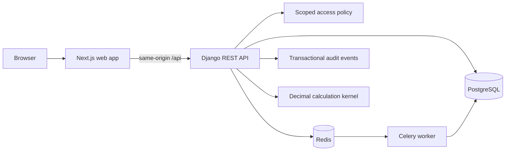

# Outcometrik

Outcometrik is an academic outcomes measurement platform for Acıbadem University. It
calculates explainable Learning Outcome (LO) and Program Outcome (PO) attainment from
course grades, versioned mappings, and weighted assessment evidence.

The repository is an Nx monorepo containing a Django REST API, a Next.js web
application, shared UI and API packages, Python domain modules, and local
PostgreSQL/Redis infrastructure.

## Table of Contents

- [Product](#product)
- [Features](#features)
- [Tech Stack](#tech-stack)
- [Project Structure](#project-structure)
- [Getting Started](#getting-started)
  - [Prerequisites](#prerequisites)
  - [Quick Start](#quick-start)
  - [Manual Setup](#manual-setup)
- [Developer Guide](#developer-guide)
  - [Workspace Commands](#workspace-commands)
  - [API Development](#api-development)
  - [Web Development](#web-development)
  - [Demo Data](#demo-data)
  - [Environment Variables](#environment-variables)
- [API](#api)
- [Testing and Code Quality](#testing-and-code-quality)
- [Architecture](#architecture)
- [Deployment](#deployment)
- [Documentation](#documentation)
- [Contributing](#contributing)

## Product

Outcometrik replaces spreadsheet-based outcomes tracking with a versioned,
auditable workflow:

1. Configure institutions, programs, courses, terms, offerings, rosters, and
   program outcomes.
2. Define syllabus versions, assessments, Learning Outcomes, and LO-to-PO
   mappings.
3. Record grades and preserve correction history.
4. Calculate reproducible LO and PO scores using decimal weighted averages.
5. Publish immutable, scoped results with evidence that students and faculty can
   trace back to the original grades and mappings.

The pilot supports administrators, program coordinators, instructors, and
students. Authorization is enforced on the server using scoped roles and direct
capability grants; hiding a control in the web application is not an access
boundary.

## Features

- **Scoped access control** — Institution, program, and offering scopes with
  role assignments, direct capabilities, revocation, and immutable audit events.
- **Academic catalog** — Institutions, departments, programs, courses, terms,
  offerings, enrollments, and instructor assignments.
- **Versioned outcomes** — Program Outcome sets and syllabus versions preserve
  the inputs used by historical publications.
- **Gradebook foundation** — Grade records, validation, correction history, and
  scoped roster access.
- **Explainable calculations** — Decimal arithmetic, weighted aggregation,
  publication freshness checks, and evidence-oriented result models.
- **Role-based workspaces** — Institution administration, coordinator,
  instructor, and student views in the Next.js application.
- **Shared frontend contracts** — Typed request handling, normalized API errors,
  cancellation, CSRF support, and public module exports.
- **Local infrastructure** — Docker Compose services for PostgreSQL, Redis,
  Django, and the Celery worker.

## Tech Stack

| Layer               | Technology                                                      |
| ------------------- | --------------------------------------------------------------- |
| **Frontend**        | Next.js 15, React 19, TypeScript, App Router                    |
| **UI**              | Tailwind CSS, shadcn/ui, Radix UI                               |
| **Server state**    | TanStack Query                                                  |
| **Backend**         | Django 5.2+, Django REST Framework                              |
| **Database**        | PostgreSQL 16 (SQLite is supported for isolated tests)          |
| **Background work** | Celery 5 with Redis                                             |
| **Python tooling**  | uv, pytest, Ruff                                                |
| **Monorepo**        | Nx 22, pnpm 12                                                  |
| **Web testing**     | Vitest, Testing Library, Playwright                             |
| **Deployment**      | Docker for the API; OpenNext and Cloudflare Workers for the web |

## Project Structure

```text
outcometrik/
├── apps/
│   ├── api/                    # Django REST API, migrations, tests, settings
│   └── web/                    # Next.js routes, providers, UI composition, E2E tests
├── libs/
│   ├── modules/
│   │   ├── access/             # Scoped authorization and administration
│   │   └── calc/               # Decimal calculation kernel
│   └── ui/
│       ├── api/                # Shared transport helpers and wire types
│       ├── core/               # Shared UI primitives
│       └── modules/             # Domain-oriented frontend packages
├── docs/                       # Product, architecture, plans, and code style
├── infra/                      # Docker Compose and database infrastructure
├── tools/                      # API, Compose, and development scripts
├── nx.json
├── package.json
└── AGENTS.md                   # Repository and contribution instructions
```

Frontend domain modules belong in `libs/ui/modules/<module>/` and expose
supported APIs through `src/index.ts`. Applications compose workflows; shared UI
and transport libraries do not depend on domain modules.

## Getting Started

### Prerequisites

- Node.js compatible with `.nvmrc`
- pnpm 12
- Python 3.13+
- uv
- Docker with Compose support
- Git

### Quick Start

From the repository root:

```sh
pnpm install --frozen-lockfile
cp .env.example .env
./tools/compose-up.sh
pnpm prepare:api
pnpm dev:web
```

Open [http://localhost:3000](http://localhost:3000). The web application
proxies `/api/*` to Django at `http://127.0.0.1:8000` by default.

The Compose stack starts PostgreSQL, Redis, the Django development server, and
the Celery worker. It applies migrations before starting the API.

### Manual Setup

To run Django on the host while keeping PostgreSQL and Redis in Docker:

```sh
pnpm install --frozen-lockfile
cp .env.example .env
./tools/compose-dependencies-up.sh
pnpm prepare:api
pnpm dev:api
```

Start the web application separately:

```sh
pnpm dev:web
```

Stop dependency services with:

```sh
docker compose -f infra/compose.dependencies.yaml down
```

For isolated API tests without PostgreSQL:

```sh
(cd apps/api && \
  DJANGO_SECRET_KEY=test \
  DJANGO_DB_ENGINE=django.db.backends.sqlite3 \
  uv run pytest)
```

## Developer Guide

### Workspace Commands

Run commands from the repository root:

| Command             | Description                                            |
| ------------------- | ------------------------------------------------------ |
| `pnpm dev:web`      | Start the Next.js development server                   |
| `pnpm dev:api`      | Start Django after syncing dependencies and migrations |
| `pnpm prepare:api`  | Sync API and module dependencies with uv               |
| `pnpm build`        | Build all Nx projects with build targets               |
| `pnpm lint`         | Run all configured lint targets                        |
| `pnpm test`         | Run all configured unit and integration tests          |
| `pnpm e2e`          | Run all configured Playwright E2E targets              |
| `pnpm format:check` | Check repository formatting                            |
| `pnpm format`       | Format supported repository files                      |

Targeted checks are preferred during development:

```sh
pnpm nx run api:test
pnpm nx run api:lint
pnpm nx run web:typecheck
pnpm nx test web
pnpm nx build web
```

### API Development

The API is a Django REST Framework application. Its domain boundaries include
health, access control, academic structure, gradebook, outcomes, and
publication-oriented services.

```sh
./tools/manage-api.sh migrate
./tools/manage-api.sh check
./tools/manage-api.sh createsuperuser
./tools/manage-api.sh bootstrap_access USERNAME --name "Your institution"
```

Use the management wrapper so commands load the same root `.env` as the Compose
stack. Domain mutations should use explicit services, constructor-injected
dependencies, the shared authorization policy, and transactional audit
handling.

### Web Development

The web application uses Next.js with feature code organized in shared public
packages:

- `@outcometrik/api` owns request transport, CSRF, credentials, cancellation,
  normalized errors, and wire types.
- `@outcometrik/ui` owns shared shadcn/ui primitives.
- `@outcometrik/<module>` packages own domain features and their public exports.
- `apps/web` owns routes, providers, application composition, and deployment.

Browser requests use same-origin session cookies. Mutations require a Django
CSRF token and send `X-CSRFToken`. Authorization, scoring, and publication rules
remain authoritative on the server.

### Demo Data

With PostgreSQL and Redis running, seed the deterministic Acıbadem University
Computer Engineering demo dataset (idempotent; safe to re-run):

```sh
./tools/manage-api.sh migrate
make seed-demo
# or: pnpm seed:demo
# or: ./tools/manage-api.sh seed_demo
```

`seed_demo` populates two M:N programs (`B.Sc. Computer Engineering` and
`B.Sc. Software Engineering`), versioned PO sets (`PO-Set v1` archived and
`PO-Set v2` active with PO1–PO11), 45 students (including PRD §5 reference
student Deniz Aydın `2023041018` with `LO1=86.0`, `LO2=82.9`, `PO1=85.0`,
`PO2=82.9`, and cumulative `PO1=86.9`), gradebook edge cases (`0.0`, `EXEMPT`,
blocking `ABSENT`, `WITHDRAWN`), direct capability grants, historical and active
publications, a pending `v2 Draft` syllabus, and initial audit log events.

Local demo credentials (set `DEMO_SEED_PASSWORD` in your local `.env` or pass
`--password` when running `seed_demo`; never hardcoded in production bundles):

| Persona             | Username / Email                   | Scope & Highlights                                                                 |
| ------------------- | ---------------------------------- | ---------------------------------------------------------------------------------- |
| System Admin        | `admin@acibadem.edu.tr`            | Institution administrator (`ACU`)                                                  |
| Program Coordinator | `emre.karahan@acibadem.edu.tr`     | Coordinator for `CSE` & `SWE`; also Instructor for `CSE 321-01`                    |
| Instructor          | `selin.kaya@acibadem.edu.tr`       | Instructor for `CSE 311-01`, `CSE 311-02`, `CSE 214-01` + direct capability grants |
| Student (PRD §5)    | `deniz.aydin@live.acibadem.edu.tr` | Student `2023041018` (Deniz Aydın)                                                 |

For the legacy Bologna catalog seed:

```sh
./tools/manage-api.sh seed_acibadem
```

Both seed commands are restricted to local `DEBUG` development with a local
database and never run in production.

### Environment Variables

Copy the relevant example before starting local development:

- `.env.example` — Compose and shared local defaults
- `apps/api/.env.example` — Host-run Django settings
- `apps/web/.env.example` — Next.js API upstream

Important variables include:

| Variable                      | Purpose                                                                   |
| ----------------------------- | ------------------------------------------------------------------------- |
| `DJANGO_SECRET_KEY`           | Django signing and session secret                                         |
| `DJANGO_DEBUG`                | Local debug mode                                                          |
| `DJANGO_ALLOWED_HOSTS`        | Allowed API hostnames                                                     |
| `DJANGO_CSRF_TRUSTED_ORIGINS` | Web origins allowed to submit CSRF-protected requests                     |
| `POSTGRES_*`                  | PostgreSQL database connection and Compose credentials                    |
| `CELERY_BROKER_URL`           | Redis broker URL                                                          |
| `CELERY_RESULT_BACKEND`       | Redis result backend URL                                                  |
| `API_UPSTREAM`                | Server-side Next.js rewrite target, defaulting to `http://127.0.0.1:8000` |

Never commit local passwords, generated credentials, production secrets, or
personal data.

## API

The API base path for domain routes is `/api/v1`. Authentication and access
endpoints are under `/api/auth/` and `/api/access/`.

The health endpoint is:

```text
GET /api/health/status
```

It returns only `{"status":"ok"}` or `{"status":"unavailable"}`. Dependency
details are intentionally not exposed.

Representative authenticated flows include:

- `GET /api/auth/session/` — current user, scopes, and CSRF cookie
- `POST /api/auth/login/` — session login
- `POST /api/auth/logout/` — session logout
- `GET /api/access/dashboard/` — scoped institution administration
- `POST /api/access/assignments/` — scoped role or capability assignment
- `GET /api/v1/...` — academic catalog and offering resources

Protected list and detail queries must filter through the shared visibility
selectors. Mutation services must authorize against stored scope and resource
facts. Hidden objects return `404`; forbidden actions on visible objects return
`403`.

## Testing and Code Quality

Run the checks relevant to the files you change:

```sh
# API
pnpm nx run api:test
pnpm nx run api:lint
./tools/manage-api.sh check
./tools/manage-api.sh makemigrations --check --dry-run

# Web
pnpm nx run web:typecheck
pnpm nx run web:lint
pnpm nx run web:test
pnpm nx run web:build

# End to end
pnpm exec playwright install chromium
pnpm nx e2e web

# Repository formatting
pnpm format:check
```

API tests cover Django, access, calculation, academic, and health behavior.
Web tests use Vitest, and browser workflows use Playwright with the disposable
E2E API setup.

## Architecture



The API is the authoritative boundary for identity, authorization, academic
records, scoring, and publication. PostgreSQL stores versioned transactional
data. Redis and Celery support asynchronous work; they do not replace the
database as the source of truth.

The calculation model uses decimal arithmetic and weighted means:

```text
score = sum(weight * source_score) / sum(weight)
```

Intermediate values are not rounded before further aggregation. Missing required
inputs, exemptions, unmapped outcomes, and stale publications remain explicit
states rather than being silently converted to zero.

## Deployment

Build the API image with:

```sh
pnpm nx run api:build
```

Build the web application locally:

```sh
pnpm nx build web
```

The web deployment target uses OpenNext and Cloudflare:

```sh
pnpm nx run web:deploy
```

Production deployments must provide a real Django secret, secure session and
CSRF cookie settings, the public HTTPS origin in
`DJANGO_CSRF_TRUSTED_ORIGINS`, managed PostgreSQL and Redis, and a private
strategy for backups, logs, exports, and generated credentials. Validate that
the ingress routes `/api/*` to Django and all other paths to the web
application.

## Documentation

- [Product requirements](docs/PRD.md)
- [System design](docs/SYSTEM.md)
- [Code style and frontend architecture](docs/CODE_STYLE.md)
- [Assessment requirements](docs/ASSESSMENTS.md)
- [Development plans](docs/plan/README.md)
- [API guide](apps/api/README.md)
- [Web guide](apps/web/README.md)
- [Repository instructions](AGENTS.md)

## Contributing

Read [AGENTS.md](AGENTS.md) and [the code style guide](docs/CODE_STYLE.md)
before making changes. Keep feature code in its owning module, use explicit
public exports, preserve module dependency direction, and add focused tests
for new behavior.

Each subtask uses a dedicated branch created from an up-to-date `main` branch.
Pull requests target `main`, use a conventional title, include a non-empty
description, follow the repository pull request template, and include the
required issue references when an issue is available.
