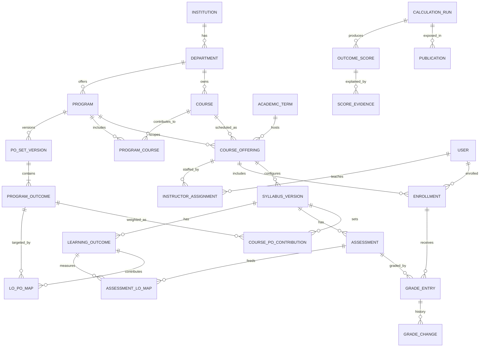
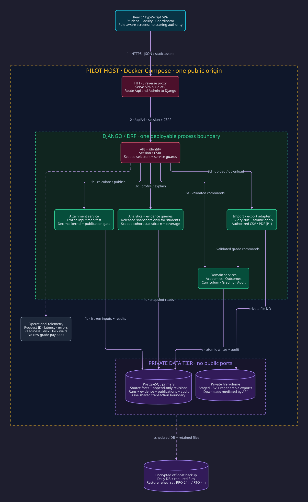
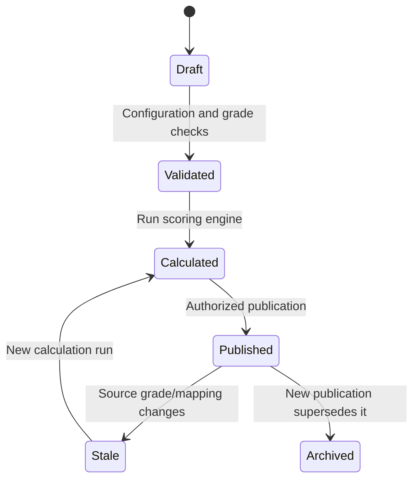

# Outcometrik
## Product Requirements Document, Domain Specification & Technical Implementation Plan

**Version:** 1.0  
**Date:** 9 October 2026  
**Courses:** CSE 311 — Software; CSE 321 — Data Systems  
**Pilot:** Acıbadem University Computer Engineering  
**Status:** Proposed design; subject to instructor validation  
**Product tagline:** Assessments → Learning Outcomes → Program Outcomes → Academic Intelligence

---

## 0. Executive summary

Outcometrik is a web application for defining academic programs and their outcomes, mapping course learning outcomes to program outcomes, recording student assessment scores, calculating weighted attainment, and presenting explainable student/program analytics.

**Primary invariant:** Every published Program Outcome (PO) score must be reproducible from a versioned chain of grade records, assessment–learning outcome links, learning outcome–program outcome links, and course contribution weights. Students see their own records; instructors see only assigned offerings; program managers see department-level results.

**Required stack:** Python and Django. **Proposed stack:** Python 3.13, Django 5.2 LTS, Django REST Framework, PostgreSQL 16+, React/TypeScript, Nextjs, TanStack Query, shadcn/ui, Tailwind CSS, pytest, GitHub Actions, Docker Compose. Choose compatible supported patch versions when bootstrapping.

**Delivery strategy:** Implement a reliable vertical slice first: configure a course → enroll students → define assessments and outcomes → enter grades → compute LO/PO scores → show traceable student profile. Then add bulk import, reports, and department intelligence.

### 0.1 Assignment-derived requirements vs design proposals

| ID | Origin | Requirement |
|---|---|---|
| A01 | Assignment | One web-based system serving both courses; Django/Python required. |
| A02 | Assignment | Manage the pilot department's eleven POs per student. |
| A03 | Assignment | Assessment → LO → PO weighted-average model. |
| A04 | Assignment | Aggregate contributions from multiple courses, using a 1–5 course relevance weight. |
| A05 | Assignment | Exactly four students per team, one GitHub repository, same team in both courses. |
| A06 | Assignment | Presentation/report in November and demo/printed reports in December. |
| D01 | Proposed | Role-based access, academic-year and syllabus versioning, batch publication and audit trails. |
| D02 | Proposed | An explicit distinction between draft/provisional and publishable scores. |
| D03 | Proposed | PostgreSQL and a separately deployed TypeScript front end. |
| D04 | Proposed | CSV bulk ingestion, evidence drill-down, health reports, PDF export. |
| D05 | Proposed | Course-to-PO weight defined independently for each course and PO. |

**Not a replacement for official institutional records:** Outcometrik's normalized assessment scores are a local measurement system, not the university's official transcript or GPA calculation.

## 1. Business goals and product metrics

### 1.1 Goals
1. Reduce spreadsheet-based setup and reporting work for instructors and coordinators.
2. Calculate each student's PO1–PO11 scores reproducibly and without manual arithmetic.
3. Identify weak outcomes across individuals, cohorts, course sections and semesters.
4. Expose the provenance of each score so faculty can audit and explain it.
5. Support piloting at Acıbadem CSE and future reuse across departments.

### 1.2 Success criteria
- **Functional:** Example grades 90 and 80 reproduce LO1=86.0, LO2=82.9, PO1=85.0, PO2=82.9.
- **Completeness:** No published PO score with missing required grades or invalid mappings.
- **Security:** Unauthorized access to another student's grades and cross-program instructor data fails.
- **Reliability:** Re-running the same calculation with the same versioned inputs yields identical values.
- **Usability:** Instructor completes a batch of 100 grade rows by CSV with validation and error download.
- **Demo:** A realistic seeded dataset demonstrates 11 POs, multiple courses, several students and reports.

### 1.3 Non-goals for the semester
Production student-information-system synchronization, plagiarism detection, official transcript issuance, full LMS replacement, automatic machine-approved syllabus mappings, chatbots, multi-tenant SaaS billing, and complex distributed microservices.

## 2. Stakeholders and access model

| Actor | Main need | Scope |
|---|---|---|
| System Administrator | Configure institutions, users, global security | Institution/system |
| Program Coordinator / Department Head | Define PO sets, manage courses, approve/publish curricula, view cohort analytics | Assigned program |
| Instructor | Configure assigned course offerings, LOs, assessments, maps, grades, review results | Assigned course offering |
| Teaching Assistant | Assist with grading/imports under delegated permission | Assigned course offering |
| Student | View own released grades, LO/PO profile, explanation and progression | Self |
| Auditor / Read-only Reviewer (optional) | Inspect published outcomes and integrity evidence | Approved program |

Roles are **assignments with scope**, not merely a global boolean. A user can teach an offering, be a student elsewhere, and coordinate one program. Deny by default; object-level query filtering is mandatory.

### 2.1 Core permission matrix

| Action | Admin | Coordinator | Instructor | TA | Student |
|---|---|---|---|---|---|
| Define/version POs | Yes | Program | No | No | No |
| Create course and offering | Yes | Program | No* | No | No |
| Draft LOs/maps/assessments | Yes | Program | Assigned | Delegated | No |
| Approve syllabus mapping | Yes | Program | Submit | No | No |
| Enter and import grades | Yes | Program | Assigned | Delegated | No |
| Publish grade batch | Yes | Program | Assigned** | No | No |
| Publish program reports | Yes | Program | No | No | No |
| View course grades | All authorized | Program | Assigned | Assigned | Own released |
| View PO profile | All authorized | Program | Assigned roster | Delegated roster | Own published |

\* An instructor may request a course creation, but coordinator creates/approves it in MVP.  
\** Instructor publication of course grades is proposed and subject to coordinator policy.

## 3. Ubiquitous language / glossary

- **Institution:** University operating the system.
- **Program:** A degree program (e.g., Computer Engineering) with a PO catalog.
- **PO (Program Outcome):** A program-level competency, numbered 1–11 for the pilot.
- **PO Set Version:** Immutable numbered collection of POs with descriptions and effective date.
- **Course:** Stable catalog identity (e.g., CSE 311), independent of semester.
- **Course Offering:** A run of a course in a specific term and section with instructors and enrollment.
- **Syllabus Version:** A frozen configuration for an offering: LOs, assessments and mappings.
- **LO (Learning Outcome):** An ability measured within a course, usually LO1, LO2, etc.
- **Assessment:** A scored activity, such as midterm, project or final, within an offering.
- **A→LO Mapping:** Weight indicating how strongly an assessment contributes to an LO.
- **LO→PO Mapping:** Weight indicating how strongly an LO contributes to a PO.
- **Course→PO Contribution:** Integer importance 1–5 when combining courses for a student PO.
- **Grade:** Student-specific raw points for an assessment, or an explicit missing/exempt state.
- **Attainment:** Computed normalized performance on a 0–100 scale.
- **Coverage:** Fraction of intended measurement inputs that are valid/present.
- **Calculation Run:** Immutable record of a scoring operation with version, inputs and results.
- **Publication:** An approved snapshot visible to its intended audience.
- **Evidence Trace:** Steps showing where a reported attainment score came from.

## 4. Academic program configuration

### 4.1 Pilot PO catalog
The pilot has exactly eleven numbered POs. Use the instructor's short labels as initial display labels; administrators must enter the exact authoritative descriptions from Acıbadem OBS and retain source URLs/version dates rather than hard-coding abbreviated slide wording as official text.

| Code | Provisional short label |
|---|---|
| PO1 | Mathematics, science and engineering knowledge |
| PO2 | Engineering problem identification and solution |
| PO3 | System design under realistic constraints |
| PO4 | Modern engineering tools and information technology |
| PO5 | Experiment design, data collection and analysis |
| PO6 | Individual and collaborative work |
| PO7 | Written and oral communication |
| PO8 | Lifelong learning |
| PO9 | Ethics and professional responsibility |
| PO10 | Project/risk/change management and entrepreneurship |
| PO11 | Health, safety, environment and legal impacts |

### 4.2 Creation and lifecycle
1. Coordinator creates `Program` and an 11-item `POSetVersion` in DRAFT.
2. PO codes are unique within the PO set; each must have a complete label, text, ordering and source.
3. Coordinator approves and ACTIVATES the set for a specified date or academic term.
4. Offerings bind to a specific PO set version via their syllabus; historical scores continue referencing that original version.
5. Changing a PO's semantics requires a new PO set version; do not overwrite history.

### 4.3 Course ownership
Course catalog has code, name, credit/ECTS metadata, owning **department**, and status. A `ProgramCourse` association identifies which catalog courses contribute to a degree program, including externally owned service courses such as MAT 241. Offerings bind one target **program** for the pilot, plus term, section, instructor memberships, enrollment roster, syllabus version and status. The same course can run in several terms and sections.

An offering is scoped to exactly one program in the MVP so its syllabus maps into precisely one PO-set version. True cross-program offerings can be added later with a separate per-program outcome-mapping layer; do not silently reuse a CSE PO mapping for another program. The cumulative calculation includes only approved `ProgramCourse` relationships and valid program-member enrollments. Students with multiple programs are excluded from the MVP unless required; the membership model allows expansion.

## 5. Core scoring specification

### 5.1 Numeric units
- All assessment grades are entered as `points_earned` out of `points_possible`; `points_possible > 0`.
- Normalize each earned grade to `score_100 = 100 × points_earned / points_possible` using `Decimal`, never binary float.
- A→LO weights (`wA`) are nonnegative relative percentages/points, normally entered 0–100. **Their sum is NOT required to equal 100** because the provided example has 40+100=140 for LO2.
- LO→PO weights (`wL`) are nonnegative relative percentages/points, normally 0–100. Their sum likewise need not equal 100.
- Course→PO weight (`wC`) is an integer from 1 to 5, chosen by the coordinator. Do not confuse it with `wL`.
- Scores are maintained at high precision internally; round to **one decimal place only at display/export** using a documented deterministic rounding rule (`ROUND_HALF_UP` is proposed).
- A zero score is a real value, never interpreted as a missing grade.

### 5.2 Stage 1: Assessment to Learning Outcome
For student `s`, course offering `c`, and LO `l`:

```
LO(s,c,l) = Σ_a [ score100(s,c,a) × wA(c,a,l) ]
            / Σ_a [ wA(c,a,l) ]
```

Only active assessments mapped to the LO with weight > 0 participate. If the denominator is 0, the LO is UNMAPPED (null score, never 0).

**Example:** Midterm=90, Project=80; LO1: Midterm=60, Project=40:
`(90×60 + 80×40) / (60+40) = 86.0`.

LO2: Midterm=40, Project=100:
`(90×40 + 80×100) / (40+100) = 82.857142... → 82.9`.

### 5.3 Stage 2: Learning Outcome to Course Program Outcome
For PO `p` within course offering `c`:

```latex
CoursePO(s,c,p) = Σ_l [ LO(s,c,l) × wL(c,l,p) ]
                  / Σ_l [ wL(c,l,p) ]
```

**Example:** PO1 is mapped from LO1 with weight 100 and LO2 with weight 50:
`(86×100 + (580/7)×50) / 150 = 84.952380... → 85.0`.
PO2 is mapped from LO2 with weight 100: `82.857142... → 82.9`.

The intermediate LO2 value **must not** be rounded to 82.9 before the PO formula is evaluated.

### 5.4 Stage 3: Cross-course student Program Outcome
For a student and PO `p` across eligible course offerings `c`:

```
StudentPO(s,p) = Σ_c [ CoursePO(s,c,p) × wC(c,p) ]
                 / Σ_c [ wC(c,p) ]
```

`wC(c,p)` is an integer 1..5 recorded for each offering/PO pair (or inherited from an approved catalog mapping). Example: CSE 311 PO1=85, relevance=5; CSE 321 PO1=90, relevance=3: `(85×5 + 90×3)/8 = 86.875 → 86.9`.

**Not the same as GPA:** The cross-course score is a weighted attainment measure; course credits/ECTS do not automatically replace relevance 1–5. If the department prefers course credits as an additional coefficient, it must be a separately approved policy version.

### 5.5 Completeness, publication and exceptions

| Case | Draft/provisional view | Publishable snapshot |
|---|---|---|
| Explicit grade 0 | Include as 0 | Include as 0 |
| Required grade absent | Calculate optional preview using present grades, marked INCOMPLETE | Block publication of affected LO/PO |
| Excused/exempt assessment | Exclude that student's assessment weight from denominator; mark EXEMPT | Permit if authorized and documented |
| LO with no positive A→LO links | UNMAPPED | Block affected PO |
| PO with no positive LO→PO links | NOT_ASSESSED | Do not publish a numerical 0 |
| No eligible course contribution | NOT_ASSESSED | Null, not 0 |
| Grade imported but not released | Available to authorized faculty preview | Not shown to student |
| Mapping/grade edited after publication | Historical snapshot unchanged; current result STALE | Require rerun and new publication |
| Student withdrew or course incomplete | Excluded by approved eligibility policy | Null and recorded reason |

**Proposed course attempt policy:** Use the latest completed, approved attempt per course catalog code when generating a student's cumulative PO profile, avoiding double counting retakes. Historical snapshots retain every attempt. This needs explicit instructor confirmation because the slides do not specify retake handling.

**Publication rule:** A student PO is publishable only when every included course PO has fully satisfied required measurement inputs, a valid approved syllabus and a valid eligibility state. If some courses are still in progress, publish a *term-specific* snapshot for completed courses or show a cumulative provisional score distinctly, rather than silently publishing incomplete cumulative results.

**Coverage:** `coverage = valid_nonexempt_expected_weight / nonexempt_expected_weight`, computed at each stage for draft reporting. A PO preview with <100% coverage should never look identical to an official published score. Exempt measurements are removed from expected weight with a reason and authorization.

### 5.6 Calculation algorithm and provenance

```python
from decimal import Decimal

def weighted_mean(values: list[tuple[Decimal, Decimal]]) -> Decimal | None:
    active = [(score, weight) for score, weight in values if weight > 0]
    denominator = sum((weight for _, weight in active), Decimal('0'))
    if denominator == 0:
        return None
    return sum((score * weight for score, weight in active), Decimal('0')) / denominator

# Never round until presentation. All inputs are normalized to 0-100.
# Resolve availability and completeness BEFORE publishing.
```

Every calculation result should retain: `student_id`, scope, PO/LO identifier, exact computed value, status, numerator, denominator, source version, grade batch version/hash, timestamp, run id, and linkable evidence items (source assessment, original grade, normalization, weight and intermediate LO).

### 5.7 Policies requiring coordinator sign-off
- Who defines course→PO weights, and whether they are term-specific or catalog defaults.
- Whether PO mappings must have full 11-PO coverage for every course (recommended: **no**, only mapped outcomes).
- Whether published program profiles include only completed courses.
- Whether all retakes count, or only latest approved attempt (recommended latest).
- Grade excusal and withdrawn enrollment treatment.
- The publication gate and grade release rules.
- Whether 1 decimal and ROUND_HALF_UP are the official output conventions.

## 6. Domain boundaries and modules

### 6.1 Identity and Access (`identity`)
Entities: `User`, `RoleAssignment`, `Membership`, `Invitation` (optional). Responsible for authentication, scoped authorization, role change audit and session management.

### 6.2 Institutional Structure (`academics`)
Entities: `Institution`, `Department`, `Program`, `AcademicTerm`, `Course`, `CourseOffering`, `InstructorAssignment`, `Enrollment`. Owns program and offering structure, roster lifecycle, course attempts.

### 6.3 Outcome Catalog (`outcomes`)
Entities: `POSetVersion`, `ProgramOutcome`. Owns official wording, numbering, activation, governance and history.

### 6.4 Curriculum Mapping (`curriculum`)
Entities: `SyllabusVersion`, `LearningOutcome`, `Assessment`, `AssessmentLOMapping`, `LOPOMapping`, `CoursePOContribution`. Owns immutable approved mapping versions and pre-publication validation.

### 6.5 Grading (`grading`)
Entities: `GradeEntry`, `GradeChange`, `GradeBatch`, `GradeImport`, `GradeException`. Owns student input facts, grade publication and correction audit.

### 6.6 Attainment Engine (`attainment`)
Entities: `CalculationRun`, `OutcomeScore`, `ScoreEvidence`, `Publication`. Domain service calculates LO, course PO and student PO; versioned read models/snapshots.

### 6.7 Analytics (`analytics`)
Entities: `ReportJob` (optional), `ReportDefinition` (optional), materialized views/cache. Responsible for dashboards, cohort comparison, trend analysis and exports; never owns source of truth.

### 6.8 Integrations and Audit (`integrations`, `audit`)
Entities: `ImportJob`, `ImportRowError`, `AuditEvent`, `ExportJob`. Responsible for CSV templates, upload validation, status and notifications.

**Boundary rule:** An app may read another app's public service/query facade; do not let views directly mutate another app's tables. No unnecessary generic repository abstractions; Django ORM remains the persistence layer.

## 7. Logical entity relationship model



**Important:** All mappings belong to a specific `SyllabusVersion`, not an unversioned global LO record. Foreign-key integrity must ensure the two endpoints of an assessment/LO mapping belong to the same syllabus, and the LO/PO endpoints of a mapping match the syllabus's PO set. These cross-row constraints generally need service validation/transactional enforcement and tests, not just simple SQL `CHECK` constraints.

## 8. Proposed relational database schema

Use UUID primary keys for business entities. Use `DecimalField`/`NUMERIC` for grade and weight values. Add `created_at`, `updated_at` for mutable records, and `created_by`/`updated_by` for sensitive changes. FKs are indexed appropriately.

| Table | Critical fields | Key constraints / indexes |
|---|---|---|
| `institution` | id, name, code | UNIQUE(code) |
| `department` | id, institution_id, name, code | UNIQUE(institution_id, code) |
| `program` | id, department_id, code, title, status | UNIQUE(department_id, code) |
| `academic_term` | id, institution_id, year, season, starts_at, ends_at | UNIQUE(institution_id, year, season), starts_at < ends_at |
| `user` | id, email, display_name, external_student_id(nullable), active | UNIQUE(email); scoped student identifiers in separate `student_program_membership` for future multi-program support |
| `program_membership` | id, program_id, user_id, student_number, admitted_term_id, status | UNIQUE(program_id, student_number); UNIQUE(program_id,user_id) |
| `role_assignment` | id, user_id, role, program_id(nullable), offering_id(nullable), active | valid role-scope combination; UNIQUE logical active role per scope |
| `po_set_version` | id, program_id, version, status, effective_from, source_url | UNIQUE(program_id,version); immutable when active |
| `program_outcome` | id, po_set_version_id, code, short_name, description, sort_order | UNIQUE(po_set_version_id,code); 1..11 for pilot |
| `course` | id, home_department_id, code, title, ects, credits, active | UNIQUE(home_department_id,code) |
| `program_course` | id, program_id, course_id, effective_from, effective_to, status | UNIQUE(program_id,course_id,effective_from); no overlapping active dates per pair |
| `course_offering` | id, program_id, course_id, term_id, section, status | UNIQUE(program_id,course_id,term_id,section); verify active program-course membership |
| `instructor_assignment` | id, offering_id, user_id, assignment_role | UNIQUE(offering_id,user_id,assignment_role) |
| `enrollment` | id, offering_id, student_id, status, attempt_number | UNIQUE(offering_id,student_id); indexes (student_id,status), (offering_id,status) |
| `syllabus_version` | id, offering_id, po_set_version_id, version, state, approved_by, approved_at | UNIQUE(offering_id,version); only one active version |
| `learning_outcome` | id, syllabus_version_id, code, description, position | UNIQUE(syllabus_version_id,code) |
| `assessment` | id, syllabus_version_id, code, name, kind, max_points, required, position | UNIQUE(syllabus_version_id,code); max_points > 0 |
| `assessment_lo_map` | id, syllabus_version_id, assessment_id, lo_id, weight | UNIQUE(assessment_id,lo_id); 0 <= weight <= 100 |
| `lo_po_map` | id, syllabus_version_id, lo_id, po_id, weight | UNIQUE(lo_id,po_id); 0 <= weight <= 100 |
| `course_po_contribution` | id, syllabus_version_id, po_id, weight | UNIQUE(syllabus_version_id,po_id); weight INTEGER 1..5 |
| `grade_batch` | id, offering_id, state, imported_by, published_at, version | UNIQUE(offering_id, version) for course-wide batches |
| `grade_entry` | id, enrollment_id, assessment_id, points_earned, status, batch_id, row_version | UNIQUE(enrollment_id,assessment_id) per active syllabus; amount in [0,max_points] through service validation |
| `grade_change` | id, grade_entry_id, old_value, new_value, reason, actor_id, changed_at | Index(grade_entry_id,changed_at) |
| `grade_exception` | id, enrollment_id, assessment_id, type, reason, approved_by | UNIQUE(enrollment_id,assessment_id) for active exception |
| `calculation_run` | id, program_id, scope, input_hash, policy_version, status, started_at, finished_at, error | INDEX(program_id,created_at), UNIQUE(scope,input_hash,policy_version) when cacheable |
| `outcome_score` | id, run_id, student_id, offering_id(nullable), outcome_type, outcome_id, score, coverage, state | Index(student_id,outcome_type), Index(run_id,outcome_type) |
| `score_evidence` | id, outcome_score_id, source_grade_id(nullable), source_outcome_score_id(nullable), numerator_component, weight, details_json | INDEX(outcome_score_id) |
| `publication` | id, run_id, scope, version, published_by, published_at, status | Index(scope,published_at) |
| `import_job` | id, kind, actor_id, state, filename, checksum, counts_json, errors_json, created_at | Index(actor_id,created_at) |
| `audit_event` | id, actor_id, action, target_type, target_id, before_json, after_json, request_id, created_at | Index(target_type,target_id), Index(created_at) |

### 8.1 FK and cascading policy
- **RESTRICT / PROTECT** deletion of any catalog or syllabus with referenced grades or published results.
- Enrollment, grades, historical curriculum versions and publications are archived logically, not hard-deleted.
- Draft-only assessments/links may be deleted if nothing downstream references them.
- Avoid delete-cascade to grades or audit logs.

### 8.2 Normalization strategy
**Transactional data is in 3NF**: program, course, mapping, grade and enrollment facts have authoritative relations. **Derived result tables are denormalized read models** with immutable calculation-run identifiers. Do not declare the normalized OLTP schema a star schema. For the report, clearly explain that an optional analytics mart would use `fact_outcome_attainment` and dimensions for student, program, course, PO and term; it is not required for the MVP.

### 8.3 Sample PostgreSQL constraints and indexes

```sql
-- Illustrative fragments; adapt types/names to actual migrations.
ALTER TABLE curriculum_assessment_lo_map
ADD CONSTRAINT assessment_lo_weight_range CHECK (weight >= 0 AND weight <= 100);
ALTER TABLE curriculum_course_po_contribution
ADD CONSTRAINT course_po_weight_range CHECK (weight BETWEEN 1 AND 5);
CREATE INDEX idx_grade_enrollment_assessment
  ON grading_grade_entry(enrollment_id, assessment_id);
CREATE INDEX idx_score_student_run
  ON attainment_outcome_score(student_id, run_id);
CREATE INDEX idx_enrollment_offering_status
  ON academics_enrollment(offering_id, status);
```

Cross-table range checks (points <= assessment.max_points) cannot be expressed as a simple PostgreSQL CHECK without denormalization or a trigger; enforce through service validation under transactions, and test database-consistent behavior. Likewise, validate that an offering is associated with its target program through `program_course`, and that the PO set on its syllabus belongs to the same program.

### 8.4 Report-required storage measurements
For the CSE 321 **final report**, measure actual table rows and raw main-heap size using PostgreSQL after loading realistic data, not fabricated counts:

```sql
SELECT n.nspname AS schema_name,
       c.relname AS table_name,
       (SELECT count(*) FROM pg_attribute a
        WHERE a.attrelid = c.oid AND a.attnum > 0 AND NOT a.attisdropped) AS columns,
       pg_relation_size(c.oid) AS raw_table_bytes,
       pg_total_relation_size(c.oid) AS total_with_indexes_toast_bytes
FROM pg_class c
JOIN pg_namespace n ON n.oid = c.relnamespace
WHERE c.relkind = 'r' AND n.nspname = 'public'
ORDER BY c.relname;
```

Use `SELECT COUNT(*) FROM each_table` for exact row counts; `pg_class.reltuples` is only an estimate. `pg_relation_size` omits indexes and out-of-line TOAST; report both raw and total for transparency.

## 9. Detailed user journeys and functional requirements

### 9.1 Program setup (`FR-100`)
- FR-101 Create institution/department/program and activate PO set.
- FR-102 Seed pilot 11 POs and store canonical source/reference.
- FR-103 Admin assigns coordinator role for a program.
- FR-104 Coordinator creates courses/terms/offerings, sets instructors.
- FR-105 Bulk/import or manually enroll students; duplicate protection.

**Acceptance:** Active program displays exactly eleven ordered POs. A prior PO version remains readable after changes.

### 9.2 Syllabus editor (`FR-200`)
- FR-201 Instructor creates draft LOs and assessments inside an offering.
- FR-202 Matrix editor for assessment→LO weights; allow 0..100 without enforced sum=100.
- FR-203 Matrix editor for LO→PO weights; allow 0..100 and sparse mapping.
- FR-204 Coordinator/instructor proposes a 1–5 contribution weight per mapped course PO.
- FR-205 Mapping validator detects orphan LOs, unreachable POs, invalid weights and incompatible version links.
- FR-206 Coordinator approves and locks syllabus version before official grade publication.
- FR-207 New revision, never in-place rewrite, after approval.

**Acceptance:** Configuration reproduces the assignment's 60/40, 40/100, 100/50/100 mappings.

### 9.3 Grade management (`FR-300`)
- FR-301 Instructor views roster × assessments grade grid.
- FR-302 Enter grade, zero, exempt or missing explicitly; inline validation.
- FR-303 CSV template download, dry-run preview, row-level validation and error report.
- FR-304 Atomic import with configurable all-or-nothing default; idempotency via checksum/idempotency key.
- FR-305 Grade correction requires reason and audit trail after publication.
- FR-306 Publication controls when students can view grade data.

**Acceptance:** A malformed row does not silently overwrite valid grades. Repeating an import with the same idempotency key does not create duplicates.

### 9.4 Outcome engine (`FR-400`)
- FR-401 Calculate normalized assessment scores with Decimal.
- FR-402 Calculate LO, course PO and cumulative student PO values.
- FR-403 Mark missing/partial/unmapped/not assessed distinctly.
- FR-404 Show numerator, denominator, intermediate scores and all source links.
- FR-405 Version/hash inputs; stale published results are flagged.
- FR-406 Publication produces immutable snapshot and records approver.

**Acceptance:** Both worked examples and all edge-case unit tests pass; recalculation after changing grade 90 to 70 updates only its dependent results in the new run.

### 9.5 Student experience (`FR-500`)
- FR-501 View published PO profile with 11 bars/radar chart and scores.
- FR-502 Inspect per-PO breakdown: courses → LOs → assessments → grades/weights.
- FR-503 Filter outcomes by academic term and historical snapshot.
- FR-504 Download own report PDF (P1) and see missing-data indicators.

**Acceptance:** Student A never receives student B's grade or report via URL manipulation.

### 9.6 Instructor experience (`FR-600`)
- FR-601 Course list and configuration readiness checklist.
- FR-602 Roster grade table and CSV import.
- FR-603 Per-course outcome distributions and weak LOs.
- FR-604 Preview impact of mapping changes before approval (P1).

### 9.7 Coordinator experience (`FR-700`)
- FR-701 Cohort-level PO averages, medians, distribution and measurement coverage.
- FR-702 Compare terms, courses and cohorts with reproducible denominators.
- FR-703 Identify unmapped POs and courses with insufficient measurement evidence.
- FR-704 Export cohort CSV/PDF and a report of how outputs were calculated.
- FR-705 Publication approval, stale result warnings, mapping version history.

**Analytics guardrails:** Show sample size `n`, coverage, publication status and PO set version. Avoid presenting a change between PO definitions as a genuine performance trend.

### 9.8 Operational/admin (`FR-800`)
- FR-801 Django Admin access for curated management and bootstrap data.
- FR-802 Audit critical mutations and access-controlled exports.
- FR-803 Health, readiness and structured application logs.
- FR-804 Backup and restore rehearsal.
- FR-805 Resettable deterministic demonstration dataset, isolated from production data.

## 10. UI/UX and information architecture

Top-level navigation is contextual by role, not one massive mixed dashboard:

- Student: **My Outcomes**, My Courses, Score Explanations, Reports.
- Instructor: **My Courses**, Syllabus & Mappings, Gradebook, Insights.
- Coordinator: **Overview**, Programs & PO Catalog, Course Offerings, Cohort Analytics, Publications.
- Admin: **Users & Roles**, Institutional Settings, Imports, Audit.

### 10.1 High-value screens
1. **Outcome Profile:** All PO1–PO11 scored bars; coverage and term selector; click a PO to drill down.
2. **Mapping Studio:** Two spreadsheet-like matrices (assessment×LO and LO×PO), validation sidebar, version status.
3. **Gradebook:** Students in rows, assessments in columns; 0 vs absent clearly distinguished; paste support.
4. **Department Overview:** Cohort heatmap, trend chart, worst-covered POs, n and coverage.
5. **Evidence Explorer:** Human-readable formula and step-by-step contributing score tree; links to input versions.

### 10.2 Visual conventions
- Missing/unmapped always appears as an em dash or `Not assessed`, never as a misleading zero-height bar.
- Incomplete/provisional results have a text status and distinct pattern, not color alone.
- Charts have keyboard-accessible data tables and explicit axes 0–100.
- Long tables support keyboard navigation, filtering, pagination and CSV export.
- All mutations have clear success/error states, navigation preserves unsaved-change prompts.

## 11. API specification — REST JSON v1

Base URL: `/api/v1`. UUIDs for resource ids. Pagination, search and role-aware filtering are consistent across collections. OpenAPI schema is generated and validated in CI. `403` for insufficient permission; `404` for resources hidden outside user's scope when minimizing enumeration risk; `409` for version conflicts; `422` or DRF-standard `400` for field validation errors (choose one contract and standardize).

| Method | Route | Purpose | Who |
|---|---|---|---|
| GET/POST | `/programs` | Browse/create programs | Coordinator/admin |
| GET/POST | `/programs/{id}/po-versions` | List/create PO sets | Coordinator/admin |
| POST | `/po-versions/{id}/activate` | Activate official catalog | Coordinator/admin |
| GET/POST | `/courses` | Course catalog | Coordinator/admin |
| GET/POST | `/offerings` | Term offerings | Coordinator/admin |
| GET/POST | `/offerings/{id}/enrollments` | Roster | Authorized faculty/coordinator |
| GET/POST | `/offerings/{id}/syllabi` | Versioned syllabus | Assigned faculty/coordinator |
| PUT | `/syllabi/{id}/assessment-lo-mappings` | Replace draft matrix atomically | Assigned faculty/coordinator |
| PUT | `/syllabi/{id}/lo-po-mappings` | Replace draft matrix atomically | Assigned faculty/coordinator |
| PUT | `/syllabi/{id}/course-po-weights` | Replace draft weights atomically | Coordinator |
| POST | `/syllabi/{id}/validate` | Configuration lint | Assigned faculty/coordinator |
| POST | `/syllabi/{id}/approve` | Lock version | Coordinator |
| GET/PATCH | `/offerings/{id}/grades` | Grid and grade edit | Authorized faculty |
| POST | `/offerings/{id}/grades/imports` | Upload CSV or create dry-run job | Authorized faculty |
| GET | `/imports/{id}` | Import progress/errors | Import owner/coordinator |
| POST | `/offerings/{id}/calculations` | Compute course outcomes | Faculty/coordinator |
| POST | `/programs/{id}/calculations` | Compute cumulative outcomes | Coordinator |
| GET | `/calculations/{id}/scores` | Retrieve a result set | Authorized scope |
| GET | `/scores/{id}/explanation` | Formula/evidence tree | Authorized scope |
| POST | `/calculations/{id}/publish` | Release approved results | Coordinator |
| GET | `/me/outcomes` | Current student's released profile | Student |
| GET | `/students/{id}/outcomes` | Authorized student history | Faculty/coordinator/self |
| GET | `/programs/{id}/analytics` | Cohort statistics | Coordinator |
| GET | `/programs/{id}/reports/export` | CSV/PDF report job | Coordinator |

### 11.1 Representative payloads

**Set draft assessment-to-LO mapping:**
```json
{
  "expected_version": 3,
  "mappings": [
    {"assessment_code":"MIDTERM", "lo_code":"LO1", "weight":"60"},
    {"assessment_code":"PROJECT", "lo_code":"LO1", "weight":"40"},
    {"assessment_code":"MIDTERM", "lo_code":"LO2", "weight":"40"},
    {"assessment_code":"PROJECT", "lo_code":"LO2", "weight":"100"}
  ]
}
```

**Student outcome response:**
```json
{
  "student_id": "<uuid>",
  "program_id": "<uuid>",
  "po_set_version": 1,
  "publication_id": "<uuid>",
  "status": "published",
  "scores": [
    {"code":"PO1", "score":"85.0", "coverage":"100.0", "state":"complete"},
    {"code":"PO2", "score":"82.9", "coverage":"100.0", "state":"complete"},
    {"code":"PO3", "score":null, "coverage":"0.0", "state":"not_assessed"}
  ]
}
```

Client inputs should represent decimal values as decimal strings to avoid precision loss. The 11-PO profile always contains every PO, but unassessed POs use `null` and status, not `0`. In the actual API, select the correct program and PO-set version via the student's program membership rather than inferring it from any course the student happens to attend.

### 11.2 API behavior and concurrency
- All bulk mutation endpoints accept an idempotency key and an `expected_version` where appropriate.
- All write operations check object-level permissions and ownership in both queryset and service layer.
- Syllabus edits use optimistic version checking; mismatches result in `409 Conflict`.
- Grade updates require active enrollment and valid matching syllabus/assessment.
- Public student endpoints expose only released and approved results.
- Use standard UTC timestamps in responses with campus-local display formatting.

## 12. System architecture



The detailed [system design](design/outcometrik.md) expands this PRD into capacity assumptions, scoped interfaces, input immutability, the publication transaction protocol, failure behavior and scaling triggers. See the [requirements](design/requirements.md), [editable D2 source](design/diagrams/architecture.d2), [publication workflow](design/diagrams/publication.svg), and [offline diagram viewer](design/architecture.html). Internal Django boxes are modules in one deployable application; future workers and replicas are conditional design options.

**Architecture pattern:** Modular monolith, thin API views, typed domain service functions, Django ORM for persistence, shared PostgreSQL transaction boundary. No Redis or Celery required initially. For a course-sized pilot, synchronous calculations or simple background jobs through a database-backed worker are enough; introduce Redis/Celery only if measured latency demands them.

### 12.1 Suggested repository tree

```text
outcometrik/
├── apps/
│   ├── api/
│   │   ├── config/                # settings, URLs, ASGI
│   │   ├── outcometrik/
│   │   │   ├── identity/
│   │   │   ├── academics/
│   │   │   ├── outcomes/
│   │   │   ├── curriculum/
│   │   │   ├── grading/
│   │   │   ├── attainment/
│   │   │   │   ├── domain.py       # pure Decimal scoring math
│   │   │   │   ├── services.py     # orchestration and transactions
│   │   │   │   ├── selectors.py    # scoped queries
│   │   │   │   └── models.py
│   │   │   ├── analytics/
│   │   │   ├── integrations/
│   │   │   └── audit/
│   │   ├── tests/
│   │   │   ├── unit/
│   │   │   ├── integration/
│   │   │   └── security/
│   │   ├── manage.py
│   │   └── pyproject.toml
│   └── web/
│       ├── src/
│       │   ├── app/               # router/providers
│       │   ├── features/          # outcomes, syllabus, grades, analytics
│       │   ├── components/
│       │   ├── api/               # generated typed client
│       │   └── lib/
│       ├── package.json
│       └── vite.config.ts
├── docs/
│   ├── prd.md
│   ├── adr/                   # architectural decisions
│   ├── diagrams/
│   ├── data-dictionary.md
│   ├── api-contract.md
│   ├── test-plan.md
│   └── course-reports/
│       ├── cse311/
│       └── cse321/
├── infra/
│   ├── Dockerfile.api
│   ├── Dockerfile.web
│   └── compose.yml
├── .github/
│   ├── workflows/
│   │   ├── ci.yml
│   │   └── deploy.yml
│   └── pull_request_template.md
├── scripts/
│   ├── seed_demo.py
│   └── measure_db.sh
├── README.md
└── .env.example
```

### 12.2 Internal service interfaces

```python
@dataclass(frozen=True)
class ScoringPolicy:
    version: str
    rounding: str
    attempt_selection: str
    require_complete_for_publication: bool

class AttainmentService:
    def calculate_offering(self, offering_id, policy: ScoringPolicy, actor_id): ...
    def calculate_program(self, program_id, cohort_filter, policy, actor_id): ...
    def publish(self, calculation_run_id, actor_id): ...
    def explain(self, outcome_score_id, actor_id): ...

class GradebookService:
    def set_grade(self, enrollment_id, assessment_id, value, actor_id, reason=None): ...
    def import_grades(self, offering_id, csv_file, dry_run, idempotency_key, actor_id): ...
```

Services enforce permissions at entry (or have authorized use-case facades), validate scoped entity relations, modify data within `transaction.atomic()`, emit audit events and invalidate affected calculation freshness.

## 13. Data integrity, concurrency and fault tolerance

### 13.1 Transaction boundaries
1. **Approve syllabus:** lock offering/syllabus row, validate all mapping/weights and matching PO version, transition DRAFT→APPROVED atomically; use `select_for_update` on conflicting mutable records.
2. **Bulk grade import:** first dry-run parse and validate; in a transaction lock relevant grade entries, write/update atomically, record import idempotency and grade history, bump gradebook version.
3. **Publish:** lock scope/publication series, revalidate `input_hash` and completeness, insert immutable publication snapshot and audit event. Stale inputs cause `409` not silent publication.
4. **Grade correction:** authorization + reason + grade history + version bump in one atomic unit.

PostgreSQL default `READ COMMITTED` is sufficient when paired with row locks, unique constraints and version checks for these operations. Escalate to `SERIALIZABLE` only if a concrete anomaly survives the design, with retry handling for serialization failures. Never assume isolation level alone replaces constraints.

### 13.2 Invalidation strategy
`input_hash = hash(policy_version, syllabus_version_id+approved revision, grade_batch_revision, eligible_enrollment_ids, contributing_course_set, po_set_version_id)` using canonical sorted serialization. Changed input causes a new `CalculationRun`; old reports remain auditable. `Publication` always points to its frozen run. A freshness query compares current hash to the published run hash.

### 13.3 Fault cases
- DB unavailable → health check fails; app errors safely; do not claim success.
- CSV malformed → dry-run errors with row/column; no partial writes in atomic mode.
- Concurrent grade update → version conflict, refresh and retry; never last-write-wins silently.
- Calculation failure → prior published result remains available; failed run has error status.
- Missing mapping → display `NOT_ASSESSED` or validation warning, not invented zero.
- File import retry → idempotency prevents duplicate writes.
- Export service failure → report can be regenerated from immutable publication.

### 13.4 Scale plan for CSE 321
- Start with indexed relational queries and bulk prefetch/aggregation; avoid N+1 operations.
- Cache or materialize **published** cohort statistics, not live editable grade inputs.
- Materialized views are optional for heavy cohort reports; refresh after publication.
- Partition append-heavy `audit_event` or `score_evidence` by time only after measuring size; premature partitioning adds complexity.
- Use PostgreSQL managed/backed-up primary and point-in-time recovery if deployed at institutional scale. Replication/read replicas are future options, **not features to claim in the semester demo without implementation**.
- Include an honest benchmark describing data volume, indexes, sample query plans and p50/p95 latency.

## 14. Security, privacy and audit

- University-grade data is private by default; use least privilege and role/object-level permissions.
- Prefer Django session authentication with secure, HTTP-only, SameSite cookies and CSRF protection for same-origin deployment; if cross-origin, explicitly design CORS, CSRF and session cookie policy.
- Hash passwords with Django's supported password hashers; enforce strong secrets and HTTPS.
- Never return grades or student records in unauthorized querysets; test direct object-reference attacks.
- Sensitive writes and exports must produce immutable audit events with actor, target, action, timestamp and a diff of permitted fields (avoid storing raw secrets).
- Uploads restricted by MIME, extension, byte limit and CSV parsing safeguards; file names are sanitized.
- Escape spreadsheet cell values beginning with formula prefixes (`=`, `+`, `-`, `@`) for CSV exports to mitigate spreadsheet formula injection.
- Rate limit login and expensive calculation/export endpoints.
- Restrict log contents; avoid printing raw grade rosters or student IDs to public CI artifacts.
- Use environment-managed secrets, database backups and a tested restore process.
- Add data retention and authorized deletion/export requirements before any real pilot deployment.
- For a course demo, **use synthetic student names, IDs and scores unless Acıbadem explicitly authorizes real data use**.

## 15. Non-functional requirements

| Quality | Target for pilot | How verified |
|---|---|---|
| Correctness | All documented calculations/edge cases pass | Unit and property-based tests |
| API latency | p95 < 500 ms for common filtered CRUD under seed load | k6/Locust benchmark |
| Scoring latency | p95 < 5 s for 1,000 students × 10 courses × typical 11 POs on stated hardware | Reproducible load test |
| Availability | App survives worker restart; previous publications remain readable | Recovery drill |
| Access | Zero known cross-student unauthorized disclosures | Security tests |
| Data integrity | All grade mutations auditable, no silent overwrite | Integration/concurrency tests |
| Accessibility | Keyboard-first tables; appropriate labels and contrast | Manual checklist |
| Maintainability | Pure calculation core, modular services, automated migrations | Code review/CI |
| Portability | One-command local DB + app bootstrap | README clean-machine test |

These are team-chosen acceptance targets, not thresholds specified by the instructor. Record exact test machine and dataset to make claims reproducible.

## 16. Testing strategy

### 16.1 Unit tests: mandatory scoring cases

| Case | Expected result |
|---|---|
| Midterm 90, Project 80, LO1 weights 60/40 | LO1 = 86.0 |
| Same grades, LO2 weights 40/100 | LO2 = 82.9 display |
| PO1 LO1×100, LO2×50 | PO1 = 85.0 display |
| PO2 LO2×100 | PO2 = 82.9 display |
| Course PO1=85 weight5, other course PO1=90 weight3 | Cumulative PO1 = 86.9 display |
| Grade 0 and weight 100 | Measured 0, not missing |
| No weighted mappings | null + UNMAPPED/NOT_ASSESSED |
| Required grade missing | Incomplete and blocked from publish |
| Authorized exemption | Renormalize excluding exempt contribution |
| Fractional grade max 20 (15/20) | Normalized 75.0 |
| Two course retakes | Only configured eligible attempt counted |
| Intermediate 82.857... | No premature intermediate rounding |
| Grade mutation after publication | Old snapshot intact, new current state STALE |

### 16.2 Property-based tests
- Adding the same positive multiplier to all weights of a single weighted mean leaves its score unchanged.
- All nonempty positive-weight means lie between min and max contributing scores.
- If all contributing scores are equal, result equals that value.
- Input permutation does not change output.
- Empty/zero-weight set returns `None`.

### 16.3 Integration tests
- AuthN/authZ across all resource scopes.
- Syllabus approve transaction and post-approval immutability.
- CSV dry-run and atomic import rollback.
- Version-conflict behavior under concurrent updates.
- Calculation snapshot reproducibility and publication correctness.
- Analytics accurately count eligible students and omit null PO values from denominators.

### 16.4 End-to-end demo test
Coordinator creates PO catalog; instructor configures CSE311; roster imported; student grades entered; LO/PO values match expected; coordinator publishes; student views their profile and score provenance; after faculty grade correction old publication remains and next publication shows changed score.

## 17. Seed data and demo story

Provide a deterministic seeder with:
- 1 institution, 1 department, 1 Computer Engineering program, 11 POs.
- 2 terms and at least 4 course catalogs including CSE311, CSE321 and MAT241.
- 4–8 course offerings across terms, instructor + coordinator + TA assignments.
- 100 synthetic students, realistic enrollments, varied scores, at least one retake.
- A few intentionally incomplete and exempt records demonstrating correctness.
- At least one full assignment example for student `Elif`: Midterm 90, Project 80; expected PO1 85.0, PO2 82.9.
- Comparison cohort with missing PO measurements and poor PO coverage, highlighting system value.

Seed must be rerunnable and deterministic; include a command to reset a **development** database only, guarded against production execution.

## 18. Feature backlog and priority

### P0 — Must finish before feature expansion
1. Auth and scoped permissions.
2. Program/PO, course/offering, roster creation.
3. Versioned syllabus LOs, assessments and both mapping matrices.
4. Grade entry and pure Decimal attainment computation.
5. Basic student profile, course report and evidence explanation.
6. Validation, audit records and baseline CI.

### P1 — Strong differentiators
1. Bulk grade CSV dry-run/import with detailed errors.
2. Cohort dashboard and student-vs-cohort comparison.
3. Syllabus upload with *reviewable proposals* (not automatic unapproved configuration).
4. PDF/CSV exports with coverage, input version and provenance.
5. Missing-coverage/lint dashboard and stale-result detection.

### P2 — Stretch
1. Rubric criterion–level mapping and scoring.
2. Longitudinal PO trends with version-aware comparisons.
3. What-if weight preview without modifying published scores.
4. University SIS/LMS connectors if official access exists.
5. Change notifications and scheduled report jobs.

**Ranking rule:** Correctness, traceability, bulk workflow and analytical value before decorative AI features.

## 19. Development process and milestones

Team registration deadline: **Tuesday, 13 October 2026**. CSE321 presentation: **Thursday, 12 November**. CSE311 presentation: **Tuesday, 17 November**. Final product/demo and hardcopy reports: **29–30 December 2026**. Midterms: CSE311 **10 November and 22 December**; CSE321 **19 November and 24 December**.

One-week sprints, with sprint planning (30 min), brief daily asynchronous check-in, end-of-week demo (30 min), backlog grooming and retro (20 min). Use GitHub Issues/Projects and story points 1/2/3/5/8, not time estimates disguised as story points.

| Window | Delivery focus | Demonstrable artifact |
|---|---|---|
| 9–13 Oct | Form team, choose name, create repo, register, document open decisions | Registered team, repo, initial backlog |
| 13–18 Oct | Requirements/ADRs, domain model, role model, skeleton project | Architecture and ERD, CI, running Django + PostgreSQL |
| 19–25 Oct | Academic schema, migrations, RBAC, fixtures | Program/courses/outcomes CRUD |
| 26 Oct–1 Nov | Curriculum and gradebook models, mapping API | Configurable mappings and grade entry |
| 2–8 Nov | Pure scoring engine, tests, minimal result API | End-to-end worked example |
| 9–17 Nov | Presentation/report checkpoint, first complete demo path | CSE321 design and CSE311 process evidence |
| 18–29 Nov | Bulk import, permission hardening, evidence browser | Instructor workflows + student dashboard |
| 30 Nov–13 Dec | Coordinator dashboard, reports, performance measurements | Cohort analysis + query plans |
| 14–20 Dec | Integration, E2E testing, fault tests, report assembly | Release candidate |
| 21–28 Dec | Exam-aware freeze, rehearsal, printed reports | Tagged tested demo build |
| 29–30 Dec | Final | Live demo, printed course-specific reports |

**Milestone gates:** By 8 Nov the numeric examples must work; by 17 Nov the system design must be defendable; by 20 Dec no high-severity defects remain; 28 Dec release is tagged and seeded.

## 20. Four-person responsibility matrix

| Member | Main ownership | Explicit deliverables | Reviewer |
|---|---|---|---|
| A — Domain/backend | Outcomes, mapping workflows, scoring engine | Domain services, formula tests, explanation API | B |
| B — Data systems | PostgreSQL schema, import, query performance | ERD, migrations, indexes, transactions, size/EXPLAIN report | A |
| C — Frontend/product | UX, gradebook, mapping studio, student and coordinator dashboards | UI feature screens, E2E tests, accessibility | D |
| D — Platform/quality | Auth/RBAC, CI/CD, deployment, security, reporting | GitHub Actions, Docker, access tests, observability, PDF exports | C |

Every member should make substantial commits, participate in reviews and contribute to both course reports. Work is cross-reviewed; no single member solely understands a crucial component.

## 21. Git workflow, CI/CD and quality gates

**Git model:** Trunk-based with short-lived `feat/*`, `fix/*`, `docs/*` branches and protected `main`; release tags `v0.1.0`, `v0.2.0`, `v1.0.0`. For the CSE311 report, document precisely whether `develop`/release branches were used; do not invent them.

**Pull request template:** goal, linked issue, schema changes, tests, screenshots if UI, affected roles, migration risk, reviewer.

**CI checks (every PR):**
1. Backend: Ruff lint/format, pytest, migration checks, Django system check.
2. Frontend: typecheck, ESLint, tests and build.
3. PostgreSQL service + migration/integration tests.
4. OpenAPI validation and API contract checks.
5. Dependency scan / secret scan (baseline).

**CD:** Docker build and deployment to a demo environment from protected main or tags. Record GitHub Actions YAML and successful/failed run screenshots/URLs for the report.

**Definition of done:** accepted business rule, migration/validation, authorization, unit/integration test, accessible UI where applicable, API docs and reviewer approval.

## 22. CSE 311 report evidence plan

The required **six sections** should be collected during development, not fabricated near the deadline:

1. **Punchline & backlog:** product description, differentiator and GitHub Projects issue/backlog process.
2. **Work & velocity:** each member's work, story point rating method, sprint cadence and measured completed points per sprint.
3. **GitHub activity:** per-person contribution charts, repo code frequency chart, linked commits and PRs.
4. **Branching model:** trunk-based branch diagram and release/tag process.
5. **CI/CD:** actual Actions YAML files, named run URLs/results and deployment record.
6. **Getting Real:** cite specific chapters/principles applied (e.g., scope reduction, iteration and useful features); verify chapter names against the assigned edition before printing.

## 23. CSE 321 report evidence plan

1. **Introduction:** product, goals and key features.
2. **System design:** deployed system architecture and UML class/object diagram.
3. **Data model:** ERD, actual table names, exact row/column counts and raw bytes; discuss normalization and any read-model denormalization.
4. **Scalability & fault tolerance:** indexes, `EXPLAIN ANALYZE`, optional materialized views, argued partitioning/replication trade-offs and tested failure responses.
5. **Consistency:** concrete transaction boundaries, READ COMMITTED isolation, locks, optimistic versions, uniqueness and mutation audit.
6. **Teamwork:** each member's implemented tasks with GitHub proof.

**Formatting constraints (both):** No separate cover/title page. At top of first page include team name, all four members and GitHub repository URL. Printed copies required at final demonstration. All illustrations/charts and code samples must remain readable at 125% zoom/view. Report content is course-specific even though product is shared.

## 24. Risks and mitigations

| Risk | Likelihood / impact | Mitigation |
|---|---|---|
| Ambiguous scoring policy and retakes | High / High | Get coordinator sign-off by project kickoff; write executable examples |
| Time lost to complex UI or AI | High / High | P0 scoring first; cap P1 work until an integrated demo works |
| Incorrect weights | Medium / High | Explicit distinct weight types and formula tests |
| Student data exposure | Medium / Critical | Synthetic data, object-level permission tests, secure exports |
| Migration conflicts across developers | Medium / Medium | Schema owner, review, isolated migration branches |
| Database demo environment fails | Medium / High | Docker Compose, local seed, known-good tagged release and DB backup |
| Reports missing evidence | High / High | Capture weekly CI, sprint velocity and SQL benchmark records |
| Midterms interrupt sprint | High / Medium | Shorter scopes/freeze near exam weeks |

## 25. Definition of project completion

The final release is acceptable only if:
- Program and PO set are configured, including the pilot's eleven outcomes.
- At least two offerings contribute to a student's cumulative PO profile using 1–5 course weights.
- A→LO and LO→PO mapping editor both function and accept the assignment's non-normalized weights.
- Grades are entered/imported, and published LO/PO results match reference examples exactly.
- A student can inspect their own scores and the provenance chain.
- A coordinator can view cohort metrics with n/coverage and export a report.
- Data remains private under tested role permissions.
- The repository is reproducibly buildable, migrations and seed work, and CI passes.
- CSE311 and CSE321 six-section reports contain their required, authentic evidence.

## 26. Decisions log and questions for instructor

1. **LO mapping weights:** Confirm assignment weights are relative and not required to add to 100 (example strongly implies yes).
2. **Course 1–5 weights:** Who assigns them? Once per course/PO or per offering/PO?
3. **Missing and exempt grades:** Should they block publication, count as zero, or be removed from the denominator?
4. **Retakes and failed/withdrawn courses:** Which attempts count toward a cumulative PO?
5. **Published vs in-progress profile:** Should students see provisional cumulative results?
6. **Approval authority:** Who activates mappings and publishes grades/PO profiles?
7. **True syllabus integration:** Any permitted access to OBS/LMS, or should CSV/manual setup be used?
8. **PO source text:** Get complete official eleven descriptions from Acıbadem OBS and version their effective text.

Default choices in this PRD are **proposals** until approved. Record answers as ADRs and reflect them in automated tests.

## 27. Immediate implementation backlog — ready for GitHub Issues

| Issue | Estimate (SP) | Dependencies | Done when |
|---|---|---|---|
| BOOT-01 Bootstrap Django/DRF and PostgreSQL | 3 | Repo | Migration & health endpoint work |
| BOOT-02 Bootstrap frontend/typed API | 3 | BOOT-01 | React calls health endpoint |
| AUTH-01 Scoped roles and authorization | 5 | BOOT-01 | Cross-role denial tests pass |
| ACAD-01 Academic program/course/program-course/offering models | 5 | BOOT-01 | CRUD + uniqueness tests pass |
| OUT-01 PO versions + pilot seed | 3 | ACAD-01 | Eleven valid POs shown |
| CUR-01 Versioned syllabus and LO/assessment model | 5 | ACAD-01 | Draft creation and approval work |
| CUR-02 A→LO & LO→PO matrices | 5 | CUR-01, OUT-01 | Versioned matrix validation works |
| CUR-03 Course→PO weights 1–5 | 2 | CUR-02 | Weight range enforced |
| GRD-01 Gradebook & grade history | 5 | CUR-01, AUTH-01 | Manual grade + audit works |
| CALC-01 Pure Decimal scoring kernel | 5 | — | Worked examples and edge tests pass |
| CALC-02 Offering & cumulative calculation | 8 | CALC-01, GRD-01, CUR-03 | Outputs and evidence stored |
| CALC-03 Publish/stale/version protocol | 5 | CALC-02 | Immutable publication test passes |
| UI-01 Mapping studio | 5 | CUR-02, BOOT-02 | Matrices editable as authorized |
| UI-02 Gradebook | 5 | GRD-01, BOOT-02 | Instructor can grade roster |
| UI-03 Student PO profile and explanation | 5 | CALC-02, BOOT-02 | User can drill to raw grade |
| IMP-01 CSV import dry-run and apply | 5 | GRD-01 | Error report + atomic apply |
| ANA-01 Cohort analytics | 5 | CALC-03 | Stats with n and coverage correct |
| EXP-01 Export score reports | 3 | ANA-01 | CSV/PDF export works |
| OPS-01 CI, demo compose, seed | 5 | BOOT-01 | Clean boot + passing CI |
| PERF-01 EXPLAIN and storage measurements | 3 | ANA-01 | Results logged for CSE321 |

Story point estimates are provisional; refine as a team at sprint planning.

---

## Appendices

### A. Canonical score lifecycle



A publication is immutable; `Stale` is a derived freshness indicator against live inputs, not an update to historical results.

### B. Key architectural decisions
- **ADR-001:** Modular Django monolith rather than microservices.
- **ADR-002:** PostgreSQL as OLTP source of truth.
- **ADR-003:** Three explicit weight types, two weighted aggregation stages plus weighted cross-course stage.
- **ADR-004:** Versioned PO catalog and syllabus approval.
- **ADR-005:** Decimal math with one-decimal display rounding.
- **ADR-006:** Immutable publication snapshots and explainability evidence.
- **ADR-007:** Role assignments scoped to programs and offerings.
- **ADR-008:** Synchronous scoring first; async task queue only if load tests justify it.

### C. Source and verification notes
- Assignment: CSE311/CSE321 Fall 2026 team-project guidelines provided by user.
- Official PO wording: https://obs.acibadem.edu.tr/oibs/bologna/progLearnOutcomes.aspx (must verify correct program and current effective version before seeding canonical labels).
- Django releases: https://www.djangoproject.com/download/
- Django REST Framework: https://www.django-rest-framework.org/
- PostgreSQL sizes: https://www.postgresql.org/docs/current/functions-admin.html#FUNCTIONS-ADMIN-DBSIZE

**Status note:** Product policy decisions marked as proposed are not asserted to be official course requirements. The product should be designed so those decisions can be altered without rewriting all historical results.
