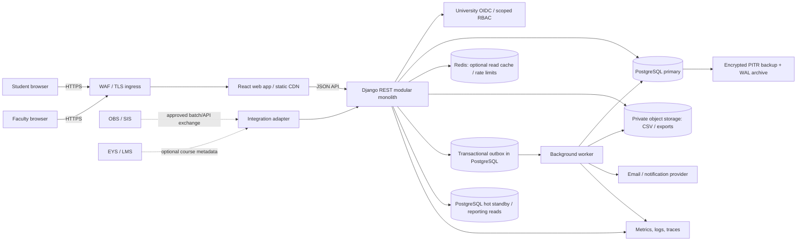
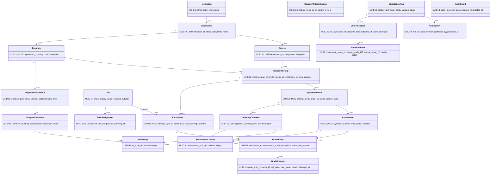

# Outcometrik System Design Specification

**Status:** Proposed architecture, ready for implementation review  
**Date:** 9 October 2026  
**Product scope:** Academic outcomes measurement and reporting for Acıbadem CSE pilot, extensible to a university-wide deployment  
**Related documents:** [Product requirements](PRD.md) · [Institutional scale research](RESEARCH-SYSTEM-DESIGN.md)

> **Evidence boundary.** Acıbadem’s published headcount is a sizing anchor, not evidence of its production database size or workload. All Outcometrik table volumes and byte sizes below are explicit planning estimates. Replace them with measurements from migrations and a representative database before making a production capacity claim.

## 1. Problem, requirements, and scope

Outcometrik stores versioned academic program outcomes, course offerings, syllabus mappings, assessment grades, and reproducible outcome calculations. It supports faculty workflows and gives students scoped access to published results. It is an analytics and assessment layer; it does not replace Acıbadem OBS, EYS, official transcripts, identity systems, or the learning management system.

### Core functional requirements

1. Maintain programs, terms, course offerings, enrollment, and immutable versions of program outcomes and syllabus mappings.
2. Record assessment grades with correction history and calculate explainable Learning Outcome (LO) and Program Outcome (PO) attainment.
3. Publish immutable results to authorized students and faculty; allow cohort summaries and exports with access control.

### Non-functional targets

| Quality | Pilot target | Initial institution-sized target | Notes |
|---|---:|---:|---|
| Covered people | 2 CSE courses; synthetic roster | 6,475 active students; 25,000 student stress case | Acıbadem reports 6,475 students in 2025–26. It reports no application-level concurrency data. |
| Request mix | 90% reads / 10% writes | 95% reads / 5% writes outside grade-release periods | Workload assumption to test. Grade entry and registration peaks differ. |
| Common API latency | p95 < 500 ms | p95 < 500 ms | Excludes exports and calculation jobs. |
| Published report latency | p95 < 2 s | p95 < 3 s | For precomputed / bounded cohort reports. |
| Calculation | <5 s for 1,000 students × 10 courses × 11 POs | Background job above 10,000 student-course enrollments per run | Acceptance targets inherited from PRD; verify on named hardware. |
| Availability | 99.5% monthly for pilot | 99.9% monthly objective for production service | Proposed service objective, not a university commitment. At 99.9%, monthly error budget is about 44 minutes. |
| Durability / recovery | Daily backup and restore rehearsal | RPO ≤5 min, RTO ≤60 min | Production proposal; point-in-time recovery plus standby needed to meet it. |
| Data protection | Synthetic data in demo; role-scoped real data | TLS, encryption at rest, least privilege, audit, approved retention | Turkish personal data law applies; institutional privacy/legal review required before live data use. |

### Explicitly out of scope

Official transcript/GPA calculation; student admissions and finance; attendance capture; raw LMS clickstream; video/content hosting; replacing OBS/EYS/UZEM; real-time messaging; AI-generated curriculum mappings; multi-region active-active writes; SaaS billing. Integrate with existing university platforms through approved identity and scheduled data exchange only.

### Load-bearing assumptions

- Acıbadem’s 6,475 students are the initial institution-scale population reference, not the pilot roster size. The current CSE project begins at course/team scale.
- A future institutional deployment covers multiple programs and historical course records, but stores only data needed for outcomes measurement. It does not ingest every SIS/LMS record.
- Capacity model uses 5 courses per student per term, 2 terms per year, 6 years of history, 25 students per section, and 4 graded assessment components per course. These are sizing assumptions, not Acıbadem operational statistics.
- Average row widths are budget estimates, excluding indexes, WAL, backups and replicas. Only PostgreSQL measurements can establish physical sizes.
- Required official PO descriptions, permitted data fields, identity integration, deletion rules, and data residency are subject to university approval.

## 2. Scale estimates

### Institutional context

Acıbadem’s 2025–26 Institutional Internal Evaluation Report states 6,475 students: 3,644 undergraduate, 2,372 associate-degree, and 459 graduate students; it also reports 585 academic and 300 administrative staff. The resulting 7,360 current student/staff identities excludes alumni, applicants, guests and duplicate accounts. The 2024 report states 6,324 students, a one-year increase of 151 (2.4%); this is one observation, not a growth forecast. [Acıbadem 2025 KİDR, pp. 2–3](https://www.acibadem.edu.tr/sites/default/files/document/2025-kidr-raporu.pdf) · [Acıbadem 2024 KİDR](https://www.acibadem.edu.tr/sites/default/files/document/2024_K%C4%B0DR_raporu-28.03.2025_0.pdf)

Acıbadem documents OBS, EYS, BademNET, AVESIS, ASOS, UZEM, online payment, and webmail integrations. Its public pages describe system capabilities but do not disclose transactions per second, simultaneous users, row counts, or bytes stored. EYS/LMS activity reporting may be asynchronous: the UZEM FAQ describes periodic completion-report updates. Do not put LMS activity telemetry on the synchronous grade-publication path. [Acıbadem IT systems](https://www.acibadem.edu.tr/en/student/life-at-acu/information-technologies) · [UZEM FAQ](https://www.acibadem.edu.tr/en/application-and-research-centers/uzem/faq)

For comparison, YÖK reports 7,330,932 students nationally in 2024 and 735,433 students at foundation universities in its 2022–23 release. These numbers describe the sector; they should not be multiplied into an Acıbadem workload estimate. [YÖK 2024](https://www.yok.gov.tr/en/Sayfalar/news/2025/women-s-access-to-higher-education-and-their-academic-presence-on-rise.aspx) · [YÖK 2022–23](https://www.yok.gov.tr/en/Sayfalar/news/2023/new-statistics-in-higher-education.aspx)

Private-university comparisons support a design range rather than one assumed size: Sabancı reports 4,983 students for 2024–25 spring, Koç reports 9,156 students for 2024–25, and Bilkent reports 10,657 full-time students for 2024–25. Definitions differ slightly by report, and none publishes application traffic or database row sizes. [Sabancı facts and figures](https://iro.sabanciuniv.edu/en/facts-and-figures) · [Koç 2024–25 report](https://cdn.ku.edu.tr/cdn/files/KU/ku24-25/files/basic-html/page4.html) · [Bilkent population data](https://sustainable.bilkent.edu.tr/energyandclimatechange2-2/)

### Capacity model for the outcomes system

This model sizes Outcometrik’s academic facts at 6,475 unique students over six years. It is distinct from the whole-university SIS estimate in the research companion, which includes attendance and LMS event stress cases that Outcometrik explicitly does not collect.

| Measure | Formula | Six-year estimate | Type |
|---|---|---:|---|
| People | 6,475 students + 585 academic + 300 administrative staff | 7,360 identities | Derived from Acıbadem report |
| Course sections | 6,475 × 5 courses/term × 2 terms × 6 years ÷ 25 students/section | 15,540 offerings | Assumption |
| Student course enrollments | 6,475 × 5 courses/term × 2 terms × 6 years | 388,500 rows | Assumption |
| Grade entries | 388,500 × 4 graded components/course | 1,554,000 rows | Assumption |
| Grade correction history | 5% of grade rows have one recorded correction | 77,700 rows | Assumption |
| Outcome score rows | 388,500 enrollments × 17 results/enrollment (6 LOs + 11 POs) | 6,604,500 rows | Assumption; one final result set per enrollment |
| Score evidence | 3 supporting input links per score on average | 19,813,500 rows | Upper planning assumption; may instead be compact immutable JSON per score |
| Audit events | 20 events/student/year × 6,475 students × 6 years | ~777,000 (rounded to 800,000) | Assumption; excludes extra staff/admin events |
| Attendance / LMS events | Not collected by Outcometrik | 0 | Explicitly excluded |

At the assumed 6,475 population, six-year modeled volume is about 15.5k offerings, 388.5k enrollments, 1.55m grades, and 6.60m outcome-score rows. At 25,000 students with the same factors, these become about 60k offerings, 1.5m enrollments, 6m grades, and 25.5m outcome scores. Growth stays within a single PostgreSQL primary and one read replica; it does not justify sharding by itself.

### Request rate and working set

Use an explicit initial performance-test profile rather than deriving RPS from enrollment headcount:

| Profile | Concurrent users | Read rate | Write rate | Purpose |
|---|---:|---:|---:|---|
| Normal academic day | 650 (10% of 6,475) | 65 req/s | 7 req/s | Profile, roster, and cohort report traffic |
| Grade-release / registration burst | 1,625 (25%) | 325 req/s | 33 req/s | Short, read-heavy burst with grade imports/publication |
| 25k learner stress case | 2,500 / 6,250 | 250 / 1,250 req/s | 25 / 125 req/s | At 10% / 25% concurrent users, 0.1 / 0.2 requests per second per user |

These rates are proposed synthetic load-test inputs, not observed university traffic. Keep a 2× headroom target over measured p95 peak before production. The likely hot working set is current term roster/grade rows, active syllabus mappings, and current published PO snapshots; do not cache mutable grades as authoritative values.

### Storage budget

For the 6,475-student, six-year scenario, approximate average heap widths are planning assumptions: narrow reference rows 0.2–0.5 KB, grade/enrollment rows 0.2–0.6 KB, score rows 0.15–0.35 KB, and evidence rows 0.2–0.5 KB. The result below rounds up and excludes indexes and operational overhead.

| Dominant table | Rows | Mean raw row budget | Approx. heap |
|---|---:|---:|---:|
| `user` | 7,360 | 1 KB | 7 MB |
| `course_offering` | 15,540 | 0.4 KB | 6 MB |
| `enrollment` | 388,500 | 0.35 KB | 136 MB |
| `assessment` | 62,160 | 0.35 KB | 22 MB |
| `grade_entry` | 1,554,000 | 0.35 KB | 544 MB |
| `grade_change` | 77,700 | 0.5 KB | 39 MB |
| `outcome_score` | 6,604,500 | 0.25 KB | 1,651 MB |
| `score_evidence` | 19,813,500 | 0.3 KB | 5,944 MB |
| Other configuration, membership, mapping, batch, import, and publication rows | ~1,200,000 | ~0.28 KB | ~337 MB |
| `audit_event` | 800,000 | 0.8 KB | 640 MB |
| **Planning total heap** |  |  | **~9.3 GB** |

Provision an initial **28 GB primary database volume** for this modeled scenario, then tune from actual database measurements. This is approximately 3× the planned heap for indexes, page slack, short-term growth and maintenance space; it is not a universal multiplier. Backups and WAL archive need separate capacity, sized from observed change rate and retention. Object storage for import files and generated reports is separate. If evidence is compacted into one provenance payload per score, the estimate decreases substantially; retain normalized evidence rows only if queryable drill-down requires them.

The actual CSE class pilot will be far smaller. Seed data and real migration measurements should be used for the semester report; do not present modeled numbers as current table counts. PostgreSQL `pg_relation_size` reports a relation’s main fork; `pg_total_relation_size` includes indexes and TOAST. [PostgreSQL size functions](https://www.postgresql.org/docs/16/functions-admin.html)

## 3. API and integration entry points

Base path: `/api/v1`. Authentication is university SSO/OIDC when approved; local development uses seeded accounts. Authorization is checked on every request using program/offering scope, not only hidden UI controls. IDs are UUIDs. List APIs are cursor or page-number paginated with a bounded page size (default 50, max 200).

| Endpoint | Purpose and contract |
|---|---|
| `GET /programs/{program_id}/offerings?term_id=` | Authorized offering list with course/section/status. |
| `GET /offerings/{offering_id}/gradebook?cursor=` | Roster and authorized grade state, page-limited; never returns students outside assigned offering. |
| `POST /offerings/{id}/grade-imports` | Multipart CSV + `Idempotency-Key`; responds `202` with job id after a dry-run preview request or accepted job. |
| `POST /grade-imports/{job_id}/apply` | Atomically applies a validated import; retry with same key returns same job/result. |
| `POST /offerings/{id}/calculations` | Creates/reuses a run for the current versioned input hash; returns `202` if async. |
| `GET /calculations/{run_id}` | Status and bounded result metadata. |
| `POST /calculations/{run_id}/publication` | Revalidates freshness/completeness and publishes immutable snapshot; stale run returns `409`. |
| `GET /students/me/outcomes?term_id=` | Student-only published outcome view; never accepts an arbitrary student id. |
| `GET /outcome-scores/{id}/evidence` | Authorized provenance chain with grade identifiers and weights, not other student data. |
| `GET /programs/{id}/reports/cohort?term_id=&po_code=` | Coordinator cohort summaries, with sample size and coverage fields. |

Use `400` for malformed input, `401` unauthenticated, `403` insufficient permission (or scoped `404` where enumeration matters), `409` stale input/version conflict, and `422` for a well-formed request that fails domain validation. Grade import application, calculation requests, and publication are idempotent by stable request key or input hash.

### Integrations

| External system | First release path | Failure behavior |
|---|---|---|
| OBS / SIS | CSV roster/course exchange or institution-approved API | Reconciliation queue; no fabricated enrollment changes; faculty can use last imported roster with visible timestamp. |
| EYS / LMS | Optional course/assessment metadata export only | Continue core grade/outcome workflow; LMS progress reports are asynchronous and out of critical path. |
| University identity / SSO | OIDC authorization code flow; provision scoped roles after verified claims | Reject new login if identity service unavailable; existing session policy bounded by institution-approved lifetime. |
| Email / notification provider | Transactional outbox → provider; only publication/import status alerts | Retry with exponential backoff and dead-letter/manual retry; publication transaction does not wait on email. |
| File/object storage | Private bucket for temporary imports and generated exports | Core grade data remains in PostgreSQL; re-export reports from immutable publication after recovery. |

No direct connection to OBS/EYS production or real personal data is approved by this specification. The interface and mapping rules require institutional approval before implementation against production systems.

## 4. High-level architecture

The current app is a **modular Django monolith** with PostgreSQL as the authoritative transactional store. React is independently served as static assets. Database-backed outbox events and a worker handle CSV processing, large calculations, report generation and notifications; no message broker is required for the pilot. Redis is optional and holds only disposable cache/rate-limit data. Add it only when measurements show a need.

| Component | Requirement / reason it exists |
|---|---|
| Browser + React | Faculty gradebook, curriculum setup, student profile and accessible reports. |
| TLS ingress / WAF | HTTPS, request limits, routing and protection for public API edge. |
| Django API | Enforce domain rules and object-scope authorization in one deployable codebase. |
| PostgreSQL primary | ACID transactions, relational constraints, versioned facts and consistent publication. |
| Worker + outbox | Keep slow imports/exports/calculations outside request deadline without losing committed work. |
| Object storage | Binary CSV and export files; relational DB stores metadata/checksum and private object key. |
| Optional Redis | Cache published, non-sensitive aggregate responses; rate limits; never source of truth. |
| Hot standby | Failover and optional stale-tolerant report reads; primary remains the only writer. |
| Telemetry / backup | Alert on service/data failures and recover from operator, host, or data-loss incidents. |
| OBS/EYS adapter | Boundary for institution-approved roster and course metadata exchange. |

### Logical module / class diagram

An example object chain is one institution `ACU` → program `CENG` → term `2026-FALL` → offering `CSE311-01` → syllabus v1 → student enrollment → grade 86/100 for `MIDTERM` → LO2 score → PO3 score → published calculation run. Student access starts from authenticated `User`, follows only their own `Enrollment`, then only published `OutcomeScore` rows.

## 5. Data model and physical sizing

### Storage strategy and modeling style

PostgreSQL is the source of truth because grade, enrollment, mapping, audit and publication invariants span related entities. The operational schema is normalized to approximately **Third Normal Form (3NF)**: users, programs, courses, offerings, syllabus maps and grade facts have one authoritative representation. This is not a star schema. `OutcomeScore` and `ScoreEvidence` are deliberately denormalized, immutable read models keyed by calculation run so published reports remain fast and reproducible. If cross-program analytics grow to many millions of result rows, create a separate star-shaped reporting mart (`fact_outcome_attainment` with student/program/course/PO/term dimensions) populated asynchronously.

All business IDs use UUIDs. Monetary or score/weight values use `NUMERIC`/Django `DecimalField`, never binary floating point. Store references to external identities rather than copying unnecessary personal attributes. Sensitive audit data is append-only and excludes passwords, tokens, raw grade CSV, and personal data not needed to explain a change.

### Table inventory and six-year planning counts

Counts correspond to 6,475 students, 585 academic staff, 300 administrative staff, the six-year course model in §2, 40 programs with six annual PO-set versions each, one or more mapping revisions per offering, and stated output factors. Counts are derived estimates. `Heap budget` is raw table-heap planning size only, rounded to MB; it is not a measured `pg_relation_size`. Column counts are logical planned columns and may change during migration review. Common `created_at`/`updated_at` fields are counted where specified. `role_assignment` contains staff and scoped admin roles; student self-access is derived from enrollment, not a student role row. Columns below are final proposed logical columns for this version.

| Table (columns) | Proposed columns | Rows (six-year) | Heap budget |
|---|---|---:|---:|
| `institution` (5) | `id, code, name, created_at, updated_at` | 1 | <1 KB |
| `department` (6) | `id, institution_id, code, name, created_at, updated_at` | 20 | <1 KB |
| `program` (7) | `id, department_id, code, title, status, created_at, updated_at` | 40 | <1 KB |
| `academic_term` (8) | `id, institution_id, year, season, starts_at, ends_at, created_at, updated_at` | 12 | <1 KB |
| `user` (9) | `id, email, display_name, external_student_id, active, created_at, updated_at, last_login_at, pii_key_ref` | 7,360 | 7 MB |
| `program_membership` (8) | `id, program_id, user_id, student_number, admitted_term_id, status, created_at, updated_at` | 6,475 | 3 MB |
| `role_assignment` (8) | `id, user_id, role, program_id, offering_id, active, created_at, updated_at` | 1,200 | 1 MB |
| `po_set_version` (8) | `id, program_id, version, status, effective_from, source_url, created_at, updated_at` | 240 | <1 MB |
| `program_outcome` (7) | `id, po_set_version_id, code, short_name, description, sort_order, created_at` | 2,640 | 1 MB |
| `course` (8) | `id, home_department_id, code, title, ects, credits, active, updated_at` | 500 | <1 MB |
| `program_course` (7) | `id, program_id, course_id, effective_from, effective_to, status, created_at` | 800 | <1 MB |
| `course_offering` (8) | `id, program_id, course_id, term_id, section, status, created_at, updated_at` | 15,540 | 6 MB |
| `instructor_assignment` (5) | `id, offering_id, user_id, assignment_role, created_at` | 31,080 | 2 MB |
| `enrollment` (7) | `id, offering_id, student_id, status, attempt_number, created_at, updated_at` | 388,500 | 136 MB |
| `syllabus_version` (8) | `id, offering_id, po_set_version_id, version, state, approved_by, approved_at, created_at` | 15,540 | 6 MB |
| `learning_outcome` (6) | `id, syllabus_version_id, code, description, position, created_at` | 93,240 | 47 MB |
| `assessment` (8) | `id, syllabus_version_id, code, name, kind, max_points, required, position` | 62,160 | 22 MB |
| `assessment_lo_map` (6) | `id, syllabus_version_id, assessment_id, lo_id, weight, created_at` | 124,320 | 50 MB |
| `lo_po_map` (6) | `id, syllabus_version_id, lo_id, po_id, weight, created_at` | 279,720 | 112 MB |
| `course_po_contribution` (5) | `id, syllabus_version_id, po_id, weight, created_at` | 170,940 | 68 MB |
| `grade_batch` (7) | `id, offering_id, state, imported_by, published_at, version, created_at` | 15,540 | 6 MB |
| `grade_entry` (8) | `id, enrollment_id, assessment_id, points_earned, status, batch_id, row_version, updated_at` | 1,554,000 | 544 MB |
| `grade_change` (7) | `id, grade_entry_id, old_value, new_value, reason, actor_id, changed_at` | 77,700 | 39 MB |
| `grade_exception` (6) | `id, enrollment_id, assessment_id, type, reason, approved_by` | 5,000 | 3 MB |
| `calculation_run` (9) | `id, program_id, scope, input_hash, policy_version, status, started_at, finished_at, error` | 15,540 | 10 MB |
| `outcome_score` (8) | `id, run_id, student_id, offering_id, outcome_type, outcome_id, score, coverage` | 6,604,500 | 1,651 MB |
| `score_evidence` (7) | `id, outcome_score_id, source_grade_id, source_outcome_score_id, numerator_component, weight, details_json` | 19,813,500 | 5,944 MB |
| `publication` (7) | `id, run_id, scope, version, published_by, published_at, status` | 15,540 | 8 MB |
| `import_job` (9) | `id, kind, actor_id, state, filename, checksum, counts_json, errors_json, created_at` | 20,000 | 12 MB |
| `audit_event` (9) | `id, actor_id, action, target_type, target_id, before_json, after_json, request_id, created_at` | 800,000 | 640 MB |

This explicit inventory budgets roughly **9.3 GB of table heap** after including configuration and audit rows (table row estimates rounded independently). This matches the full §2 model; at 3× capacity headroom, reserve about **28 GB primary storage**. Validate it against an actual generated dataset and `pg_total_relation_size` before deployment.

### Constraints and index plan

Primary keys and unique constraints are database-enforced. Important composite unique constraints: `(institution_id, year, season)`, `(program_id, student_number)`, `(program_id, user_id)`, `(program_id, version)`, `(offering_id, version)`, `(offering_id, student_id)`, `(enrollment_id, assessment_id)`, `(assessment_id, lo_id)`, `(lo_id, po_id)`, `(run_id, student_id, outcome_type, outcome_id)`. Use `PROTECT`/`RESTRICT` for referenced academic records; do not cascade-delete grade history, published results, or audit.

| Index type | Use |
|---|---|
| B-tree primary/unique | IDs, email, course/program codes, FK joins, exact gradebook lookup. PostgreSQL creates these for primary/unique constraints. |
| Composite B-tree | `(offering_id, status, student_id)` roster; `(student_id, status, offering_id)` student progression; `(run_id, student_id, outcome_type)` report lookup; `(grade_entry_id, changed_at DESC)` correction history. Order columns to match filter prefixes and sort order. |
| Partial B-tree | Active role assignments and unpublished/draft work queues (`WHERE active`, `WHERE state IN (...)`) if query plans show benefit. |
| GIN | Optional only for actual JSON containment/full text search; do not index every JSON field. |
| BRIN | Candidate for append-only `audit_event(created_at)` once large and physically time-correlated; verify `EXPLAIN ANALYZE`. |

Start with B-tree. Avoid speculative indexes because each adds disk and write cost. Use `EXPLAIN (ANALYZE, BUFFERS)` for roster, student profile, publication, and coordinator report queries on both pilot and generated 6-year data.

### Partitioning and analytics

Do not partition pilot tables. At institution scale, first candidate is append-heavy `audit_event` by month or quarter on `created_at`; second candidate is `score_evidence` by calculation/run date if retention and table maintenance become material. Partition only when measured table size, vacuum/retention work, or query latency justifies the extra migration and uniqueness complexity. PostgreSQL declarative partition pruning only helps when filters constrain the partition key. [PostgreSQL table partitioning](https://www.postgresql.org/docs/16/ddl-partitioning.html)

No materialized view or OLAP cube is required for the pilot. Published cohort statistics can be cached or materialized after publication, keyed by `(program, term, publication_version)`, with explicit refresh/invalidation. Draft grades and live previews always query the primary so they are not stale. If cross-term analytical joins become slow after measurement, create a star-schema reporting mart asynchronously; it is a rebuildable projection, not the write authority.

## 6. Consistency, transactions, and concurrency

PostgreSQL `READ COMMITTED` is the default and remains the proposed isolation level for normal requests. Each statement sees rows committed before that statement; two reads in one transaction can see different commits. Use short transactions, row locks, constraints, and optimistic version fields for the domain races. Use `REPEATABLE READ` for multi-query snapshot exports that require one consistent view, or `SERIALIZABLE` only for a demonstrated cross-row anomaly with serialization retry handling. PostgreSQL documents these semantics and its default. [PostgreSQL transaction isolation](https://www.postgresql.org/docs/16/transaction-iso.html)

| Operation | Atomic work | Isolation / coordination | Failure result |
|---|---|---|---|
| Syllabus approval | Validate matching PO set and mappings; transition version state; create audit event | `READ COMMITTED`; `SELECT FOR UPDATE` on offering/syllabus; uniqueness and check constraints | Roll back all changes; caller receives validation or `409` conflict. |
| Grade correction | Authorize; compare `row_version`; update grade; insert immutable old/new/reason history; bump version; audit | `READ COMMITTED`; row lock or compare-and-swap version predicate | Stale update returns `409`; no silent last-write-wins. |
| CSV grade import | Check idempotency key and checksum; validate all rows; write grade entries/history/import status in one apply transaction | Dry run outside write transaction; short `READ COMMITTED` apply; unique keys prevent duplicates | Any invalid row or DB error rolls back apply; dry-run errors identify row/column. |
| Calculation | Snapshot versioned inputs; compute pure Decimal result; persist run, scores, evidence | `REPEATABLE READ` snapshot or immutable input revision; avoid holding locks during long computation | Failed run marked failed; previous publication remains available. |
| Publication | Lock publication scope; recompute input hash/completeness; insert publication and audit event | `READ COMMITTED` with row lock and unique version; recheck source versions before commit | Changed source returns `409`; never publishes stale calculation. |
| Notification | Insert outbox row in same transaction as publication/import state | Same DB transaction; worker delivers after commit | Notification retry cannot roll back valid publication. |

Django defaults to autocommit; use explicit `transaction.atomic()` for these units and keep blocks short. Use `transaction.on_commit()` only to wake the worker; the durable outbox row is already committed. Django warns that per-request wrapping adds overhead and recommends deliberate transaction boundaries. [Django transaction management](https://docs.djangoproject.com/en/5.2/topics/db/transactions/)

## 7. Scalability, fault tolerance, and operations

### Replication and backups

Production deployment: one PostgreSQL primary, one hot standby in a separate failure domain, encrypted continuous WAL archive, daily base backup, and tested point-in-time restore. Start with asynchronous streaming replication to avoid adding network RTT to every commit; monitor lag. A promotion can lose transactions not yet replayed, so enforce the stated RPO through synchronous replication only if the institution accepts increased write latency and behavior when the standby is unavailable. PostgreSQL synchronous replication waits for standby confirmation and trades commit latency for durability; async replication can have lag/data loss at failover. [PostgreSQL high availability](https://www.postgresql.org/docs/16/high-availability.html)

PostgreSQL does not itself choose/promote a new primary safely; production needs managed database failover or an explicitly operated failover manager, plus split-brain prevention and connection endpoint management. A standby is not a backup: deletion/corruption replicates, so retain independent point-in-time backups and test restore. Read replicas may serve explicitly stale-tolerant coordinator reports, never grade confirmation or publication verification.

### Failure behavior

| Failure | User-visible behavior | Recovery |
|---|---|---|
| API worker/process | In-flight request fails; other workers continue; browser retries safe GET/idempotent operation | Health checks remove failed worker; container restarts; request ID supports diagnosis. |
| PostgreSQL primary | Writes and authoritative reads unavailable until promotion; cached published reports may be shown with a “last updated” timestamp | Promote standby through managed/controlled failover; reconcile uncertain commits by idempotency key; point-in-time restore if corruption. |
| Replica lag/outage | Serve reports from primary or report unavailable; do not serve replica for read-your-write | Remove replica from routing; alert on replay lag; rejoin after catch-up. |
| Redis unavailable | Bypass cache and rate limit locally/conservatively; correctness unaffected | Rebuild cache from published DB state; use TTL and request coalescing to avoid stampede. |
| Worker/queue stopped | Imports/calculations remain queued and show pending; existing publication visible | Worker resumes from outbox; idempotent handler and bounded retry with dead-letter state. |
| OIDC/identity provider down | New login unavailable; do not weaken auth; existing session remains until normal expiry | Restore IdP connectivity; audited emergency access is separately approved. |
| Email provider down | Core transaction succeeds; notification delayed and retried | Exponential backoff and dead-letter dashboard; never resend duplicate publication. |
| Object store down | New upload/export fails clearly; gradebook and stored publication remain available | Retry upload/export; report can be regenerated from DB publication. |
| Bad import / malicious file | Reject before apply; no partial grade writes | Validate size/type/checksum, quarantine, return sanitized row-level error. |

### Observability and service objectives

Collect request latency/error rate, DB pool saturation, slow query count, lock waits, deadlocks, connection count, replication lag, storage/WAL growth, backup age/restore drills, queue/outbox age, failed jobs, import row counts, calculation duration, and publication conflicts. Use dashboards and alerts for SLO burn, disk 70/80/90%, replica lag threshold, oldest queue item, and last successful backup. Logs carry request/actor/resource IDs but not full grades, access tokens, CSV rows, or unnecessary PII. Turkish Law No. 6698 establishes personal-data processing obligations; institution counsel/data-protection staff must approve lawful basis, processor contracts, retention, access, and any cross-border transfer before production. [KVKK English law text](https://www.kvkk.gov.tr/Icerik/6649/Personal-Data-Protection-Law)

### Security controls

- TLS in transit; database and object-storage encryption at rest; managed secrets; key rotation.
- OIDC, MFA according to university identity policy, scoped role assignments, deny by default, and object-level authorization in query selectors.
- Separate identifiers from student display data where practical; never place student ID/email in URLs, metrics, or broad logs.
- Audit sensitive grade changes, approvals, publication, exports, role changes, and failed access without storing secrets or entire grade rosters.
- Private object bucket, short-lived signed download URLs, upload size/type checks, malware scanning if the deployment supports it.
- Retention and deletion workflow aligned with university records schedules and applicable law; grade evidence retention is not assumed indefinite.

## 8. Decisions, trade-offs, and evolution

| Decision | Solves | Worsens | Change when |
|---|---|---|---|
| Modular Django monolith | Single transaction boundary, simple team deployment, clear domain modules | One release unit and shared runtime; module boundaries need discipline | Independent modules need different scaling/release cadence or sustained team ownership demands service separation. |
| PostgreSQL OLTP | Referential integrity, transactional grade workflows, portable reporting SQL | Vertical capacity ceiling and shared read/write contention | Measured storage/query/workload exceeds a tested primary’s capacity; first optimize/replicate/mart, then consider partitioning/sharding. |
| 3NF source tables + immutable result projection | Source clarity and reproducible published outcomes | Duplicated result data and invalidation/version logic | Reporting read patterns require a dedicated star-schema mart. |
| Background worker + DB outbox | Durable asynchronous jobs without operating Kafka early | Polling/worker throughput and at-least-once handling complexity | Sustained queue backlog or independent consumer scale requires a broker/stream. |
| Optional Redis | Faster repeated aggregate reads and rate limits | Cache invalidation and extra failure surface | Add only after measured database load/latency warrants; remove if not useful. |
| Async replica by default | Lower write latency and read scaling | Replica can lag; uncertain acknowledged transaction loss on failover | RPO requirement justifies sync commit delay, or managed platform provides an accepted equivalent. |
| No sharding / partitioning at launch | Keeps constraints, migrations and queries simple | Large append-only tables may increase vacuum/retention cost | Heap/index size, maintenance, or query plan evidence shows a single primary cannot meet SLO. |

### 10× and 100× path

- **10× requests:** Add API workers and connection pooling; protect PostgreSQL connection counts; cache only published aggregates; move cohort reports to replica/read mart; run calculations and exports through worker queue.
- **10× result rows:** Partition retention-heavy audit/evidence by time only after a measured threshold; batch writes and bulk fetch inputs; reduce provenance row fan-out if evidence is not used independently.
- **100× population / several universities:** Add institution-level tenancy constraints to every key and authorization query; isolate institutional datasets when governance requires it; use a warehouse/star schema for cross-institution reporting. Evaluate database-per-institution or partitioned tenancy before any shared-shard plan.
- **Multi-region:** Keep single-writer institution home region. Use regional disaster-recovery standby and tested DNS/connection failover. Active-active writes are out of scope because grade/publication conflicts require a much more complex consistency protocol.

The first likely bottleneck is inefficient cohort/report queries or excessive score evidence fan-out, not raw grade-write QPS. The evolution trigger is measured p95/p99 latency, queue age, database CPU/IO, lock waits, index/heap growth, or replica lag violating the §2 objectives for two consecutive peak test periods.

## 9. Measurement plan and open questions

Before a production pilot, obtain only aggregate or de-identified data from authorized system owners:

1. Current active learner/faculty counts by program and term; course registrations per student; section sizes; assessment count and grade correction rate.
2. Peak 5-minute concurrency, read/write/API request rates, top query latency and database connection counts during registration, exam, and grade-release periods.
3. Representative `COUNT(*)`, `pg_relation_size`, `pg_total_relation_size`, index sizes, row-width distributions, WAL/day, and retention policy for the Outcometrik schema.
4. Import/export file count and byte distribution; audit event rates; identity and roster synchronization schedule, failure rate, and backlog.
5. Approved data fields, legal basis, retention/deletion, residency, breach response, RPO/RTO, availability objective, and system owner for OBS/EYS/identity integration.

The research companion documents public Acıbadem/YÖK facts and the lack of public table-size/concurrency figures. Do not claim Acıbadem’s production database is 28 GB: that is an Outcometrik planning budget under explicit six-year assumptions.

### Design quality self-check

| Dimension | Score / 5 | Remaining gap to reach 5 |
|---|---:|---|
| Requirements and scope | 4 | Instructor and university data-owner approval for workflow, real data, and privacy constraints. |
| Quantified scale | 4 | Replace synthetic rates and row widths with anonymized counts and a measured load test. |
| API / model specificity | 4 | Align column inventory and unique keys to actual Django migrations once implemented. |
| Trade-offs | 4 | Obtain hosting constraints, database service options, and latency budget from the deployment owner. |
| Failure handling | 4 | Execute and record restore, worker-loss, failover, IdP outage, and queue recovery drills. |
| Consistency | 4 | Validate lock/version strategy with concurrent grade-import and publish integration tests. |

Weakest dimension is measured scale: public university reports give headcount, not service request or database telemetry. The next concrete evidence is aggregate production counts plus an anonymized representative load test; until then, storage and QPS remain design budgets rather than institution facts.

## References

1. Acıbadem University, [2025 Institutional Internal Evaluation Report](https://www.acibadem.edu.tr/sites/default/files/document/2025-kidr-raporu.pdf).
2. Acıbadem University, [2024 Institutional Internal Evaluation Report](https://www.acibadem.edu.tr/sites/default/files/document/2024_K%C4%B0DR_raporu-28.03.2025_0.pdf).
3. Acıbadem University, [Information Technologies and system descriptions](https://www.acibadem.edu.tr/en/student/life-at-acu/information-technologies).
4. Acıbadem University UZEM, [FAQ](https://www.acibadem.edu.tr/en/application-and-research-centers/uzem/faq).
5. YÖK, [Higher education population, 2024](https://www.yok.gov.tr/en/Sayfalar/news/2025/women-s-access-to-higher-education-and-their-academic-presence-on-rise.aspx); [2022–23 statistics](https://www.yok.gov.tr/en/Sayfalar/news/2023/new-statistics-in-higher-education.aspx).
6. PostgreSQL 16, [Transaction isolation](https://www.postgresql.org/docs/16/transaction-iso.html), [Table partitioning](https://www.postgresql.org/docs/16/ddl-partitioning.html), [High availability and replication](https://www.postgresql.org/docs/16/high-availability.html), [Database size functions](https://www.postgresql.org/docs/16/functions-admin.html).
7. Django 5.2, [Database transactions](https://docs.djangoproject.com/en/5.2/topics/db/transactions/), [Database connections](https://docs.djangoproject.com/en/5.2/ref/databases/).
8. Türkiye Personal Data Protection Authority (KVKK), [Personal Data Protection Law No. 6698](https://www.kvkk.gov.tr/Icerik/6649/Personal-Data-Protection-Law).
9. Project context and schema: [Outcometrik PRD](PRD.md), particularly §§7–8, 12–15, 23.

