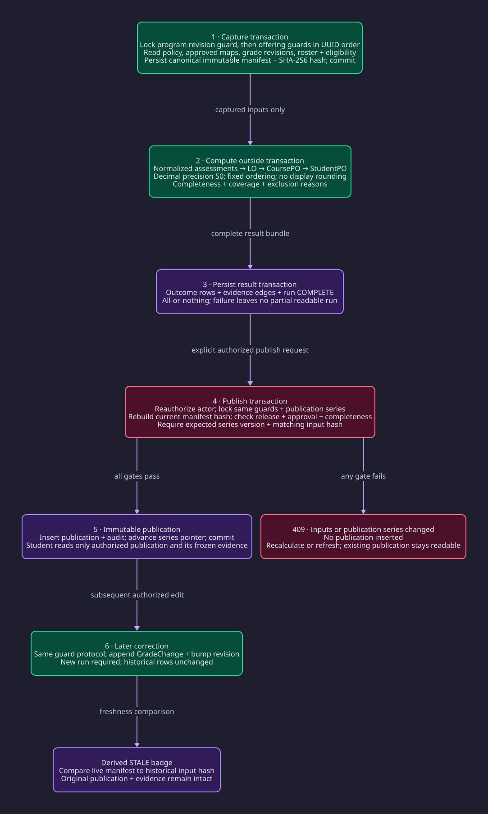

# Outcometrik — system design

**Status:** proposed implementation architecture derived from [PRD v1.0](../PRD.md). **Date:** 9 October 2026. This document specifies intended behavior; it does not claim the repository already implements it.

Outcometrik uses a modular Django monolith and a PostgreSQL primary. The central design constraint is reproducibility: a publication must retain the actual inputs and calculation policy that produced it, rather than depend on mutable grade records. A separately built React SPA shares the API's public origin. The semester pilot starts with synchronous scoring and bounded imports; scaling additions are conditional on measured bottlenecks.

## 1. Problem and scope

The four core capabilities are versioned curriculum setup, scoped grade management, explainable weighted attainment with immutable publication, and role-appropriate profiles/analytics. [Requirements and assumptions](requirements.md) capture the scope and proposed operating targets. PRD A01–A04 are authoritative assignment constraints; PRD D01–D05 and the policies in §5.7 remain proposals.

The design preserves eleven POs per pilot profile, three distinct weights, null/unassessed versus measured zero, faculty previews versus released student views, and immutable approved PO/syllabus versions. There is no official transcript/GPA function, SIS integration, automatic approval, cross-program offering or distributed service deployment.

## 2. Scale and capacity hypothesis

Numbers below are planning assumptions, not measurements or claims about the university's enrollment. Assume 1,000 active students, 10 enrollments/student/year, 8 assessments and 6 LOs per offering, 11 possible POs, and four retained calculation runs/year per student-offering. Unmapped rows may make actual counts lower.

| Quantity | Derivation | Estimate |
|---|---|---|
| Grade facts/year | 1,000 × 10 × 8 | 80,000 |
| Peak reads | 200 concurrent users × 1 read/5 s | 40 requests/s |
| Peak writes | 50 concurrent editors × 1 save/5 s | 10 requests/s |
| Grade fact/history bytes | 80,000 × 3 revisions × 500 B | 120 MB/year |
| Outcome rows | 4 × (10,000 × (6 LOs + 11 course POs) + 1,000 × 11 student POs) | 724,000/year |
| Outcome row bytes | 724,000 × 300 B | 217 MB/year |
| Evidence edges | 4 × (10,000 × (8 × 3 assessment links + 6 × 3 PO links) + 1,000 × 10 × 11 course links) | 2,120,000/year |
| Evidence bytes | 2,120,000 × 400 B | 848 MB/year |
| Frozen manifest allowance | 4 × 80,000 grade facts × 700 B, excluding large duplicated descriptions | 224 MB/year |
| Estimated derived + grade storage | 120 + 217 + 848 + 224 MB | ~1.41 GB/year |
| Provisional physical allowance | Logical storage × 3 for indexes/row overhead/slack | ~4.2 GB/year |
| Mean storage growth | 4.2 GB / 365 days | ~11.5 MB/day; strongly seasonal |
| Peak JSON egress | 40 reads/s × 20 KB/response | 0.8 MB/s ≈6.4 Mbit/s |
| Single full-program input | 80,000 grade facts × 700 B | ~56 MB serialized; Python object overhead additional |

A typical run produces ~181,000 score rows and ~530,000 evidence edges. Their persistence, not just weighted arithmetic, may break the five-second target. Benchmark input capture, calculation, evidence construction and bulk insert separately. Start with batched ORM reads and `bulk_create`; forbid one query per grade or evidence edge. Chunk loading and persistence within the result transaction if memory is excessive. Multiple simultaneous whole-program runs are disallowed initially: one active calculation per program scope; bound other expensive commands independently.

Budget a proposed 4-vCPU/8-GB host and at least 30 GB of free data space for the pilot, subject to load tests. This is a starting test environment, not proven capacity. Upload/report bytes and retained audit traffic need actual measurement. The request count alone does not determine database query capacity. Single-primary relational storage is sufficient as a hypothesis; neither sharding nor caching is yet justified.

## 3. Runtime architecture and flows


[D2 source](diagrams/architecture.d2) · [Offline architecture viewer](architecture.html) · [Publication protocol](diagrams/publication.svg).

The diagram shows one deployed Django application. Internal module arrows are function/service calls, not network RPC. Solid arrows are synchronous calls or I/O. Dashed arrows carry operational telemetry or scheduled backup work. Request branches 3a–3d are alternatives, not four sequential steps.

| Component / boundary | Responsibility and justification |
|---|---|
| React/TypeScript browser SPA | Mapping studio, gradebook, profiles and accessible explanations (FR-200/300/500); no authorization/scoring authority |
| HTTPS reverse proxy | One public origin, static build serving and API/admin routing; preserves PRD session/CSRF model |
| API + identity | DRF serialization, Django sessions, query scoping and service-level permissions (FR-100; PRD §2/14) |
| Domain services | `academics`, `outcomes`, `curriculum`, `grading`; transactions and audit of authoritative facts (FR-100/200/300) |
| Attainment | Pure scoring kernel plus input capture, evidence and publication orchestration (FR-400) |
| Analytics/evidence selectors | Read immutable publications for students; faculty previews are a distinct query path (FR-500/700) |
| Import/export adapter | Bounded private uploads, dry-run, atomic apply, authorized downloads (FR-303/304/704) |
| PostgreSQL | Relational integrity, revision history, shared transaction boundary and immutable read models (PRD §8/13) |
| Private file volume | Temporary CSV and regenerable exports; never public static/media routes |
| Operational telemetry | Request IDs, errors, readiness and saturation signals (FR-803); separate from durable domain audit |
| Off-host backups | Database and necessary retained files; host loss recovery (FR-804) |

**Grade command:** browser → proxy → API guard → grading service → locked grade mutation, append history, revision increment and audit in one transaction. The response includes the new revision. TanStack Query invalidates the local gradebook/profile preview query after success; it is not a shared source-of-truth cache.

**Student read:** browser → scoped selector → current authorized publication → immutable score/evidence graph. The API verifies student ownership, publication audience and grade release before serializing. It never trusts UI navigation to enforce scope.

**Coordinator report:** scope and PO-set version filter → approved publication scores → cohort statistics with `n`, coverage, exclusions and publication identity. Means/medians must state which valid records are included. Different semantic PO versions are shown separately, never silently merged into trends.

**Delivery:** GitHub Actions tests/builds the API and SPA, validates diagrams/OpenAPI, and produces versioned images/static artifacts. Deployment applies reviewed migrations, runs a smoke test and switches application artifacts. CI is a delivery path, not part of a user request. Keep release control separate from runtime data credentials. Database and private-file volumes survive container replacement.

## 4. Module contracts and API

Use thin DRF views, authorized use-case services, read-only selectors and Django ORM. An app calls another app's public facade; it does not directly write its tables. `attainment/domain.py` accepts immutable input structures and returns result structures without ORM/network access. `services.py` owns capture/persistence/publication; `selectors.py` owns permission-aware reads. Analytics cannot rewrite results.

Keep PRD §11 routes and choose **400** for DRF validation consistently, **409** for stale expected versions/key conflicts, **404** for hidden objects and **403** for visible forbidden actions. Proposed API additions clarify import apply, grade release and conditional publication:

| Route | Contract |
|---|---|
| `PATCH /api/v1/offerings/{id}/grades` | Expected gradebook revision, assessment/enrollment IDs, decimal string or explicit missing/exempt state; new revision on success |
| `POST /api/v1/offerings/{id}/grades/imports` | Multipart CSV, dry-run mode and expected revision; returns validation job and checksum |
| `POST /api/v1/imports/{id}/apply` | **Addition:** validated import identity + expected revision + idempotency key; revalidate then apply atomically |
| `POST /api/v1/offerings/{id}/grade-batches/{batch_id}/release` | **Addition:** scoped release authority + expected revision; immutable released batch/version used by student-visible calculations |
| `POST /api/v1/offerings/{id}/calculations` | Scope, policy version, expected revision; synchronous `201`, or `200` for same completed content |
| `POST /api/v1/programs/{id}/calculations` | Explicit term/cohort/PO-set version and attempt policy; same result semantics |
| `POST /api/v1/calculations/{id}/publish` | Expected input hash + publication-series version + audience; `201` or `409` |
| `GET /api/v1/me/outcomes?term_id=…&publication_id=…` | Published self-only eleven-PO profile, null states, version, freshness, coverage |
| `GET /api/v1/scores/{id}/explanation` | Authorized, paginated evidence nodes linked to frozen sources |

Example publication command:

```http
POST /api/v1/calculations/<run-uuid>/publish
Idempotency-Key: <opaque-command-key>
Content-Type: application/json
X-CSRFToken: <csrf-token>

{"expected_input_hash":"<sha256>","expected_series_version":4,"audience":"students"}
```

```json
{
  "publication_id": "<uuid>",
  "run_id": "<uuid>",
  "series_version": 5,
  "input_hash": "<sha256>",
  "published_at": "<UTC timestamp>",
  "freshness": "current"
}
```

Decimal values travel as strings; public scores use one decimal. Collections default to 50 items, maximum 200. Evidence pagination uses stable IDs/order and a fixed run so rows cannot shift during corrections. Idempotency records are unique by actor + operation + scope + key, retain canonical request hash and committed response identity, and reject different payloads under the same key. Reauthorize on replay; an old key is not an access token. Keep keys for at least the import/report retry window; proposed 30 days, separate from permanent import/publication audit retention.

Sessions use Secure/HttpOnly/SameSite cookies, explicit CSRF checks for mutations, HTTPS and private/no-store headers on sensitive responses. Same-origin delivery avoids needing a separate JWT lifecycle. Roles are scoped assignments; selector, service and download checks must cover self, assigned offering and coordinator program separately. Django Admin actions must invoke the same services, or be read-only for guarded data.

## 5. Data model and input immutability

PRD §7–8 provides the relational model. Retain UUID business keys and normalized transactional relations, with denormalized immutable calculation read models. PostgreSQL fits the FKs, scoped joins and atomic publication requirement. No shard/partition key is required initially.

### Architecture refinements to the proposed schema

| Record | Required refinement | Reason |
|---|---|---|
| `ProgramRevisionGuard` | One row/program; `eligibility_revision`, `policy_revision`, `publication_revision` | Locking an existing row also protects changes to membership and new offerings; locking current children alone cannot protect inserts |
| `CourseOffering` | Monotonic `input_revision`; all affecting writes lock this row | Grade, release, roster, exception and active syllabus changes must be detected |
| `GradeChange` / immutable batch | Full resulting value/state, previous revision, actor/reason and stable source ID | `GradeEntry` remains the current value; evidence never resolves it as historical truth |
| `CalculationRun` | Canonical scope key, `engine_version`, `policy_version`, numeric context, immutable input manifest, hash and lifecycle | Hashes prove identity but do not retain the underlying inputs |
| `OutcomeScore` | Unique `(run, student, outcome_type, offering-or-scope, outcome)` | Duplicate bulk insert/retry cannot silently duplicate scores; handle nullable offering with type-specific constraints |
| `ScoreEvidence` | Frozen raw grade/max points, states, weights and version refs; parent/child outcome IDs | Historical explanations survive correction or syllabus replacement |
| `PublicationSeries` | Unique program + PO-set + scope + audience; monotonic version and latest pointer | Serializes competing publications without changing historical snapshots |
| `Publication` | Immutable row with run, publisher, audience, series/version; supersession in series/events | Stale/archived are derived relationships, not destructive edits |
| `IdempotencyRecord` | Scoped unique key, request hash, response reference | Retried commands have a stable committed result |

**Input manifest:** engine and policy version; Decimal context; exact PO-set and syllabus configuration; sorted assessment/LO/PO maps; per-grade immutable revision/value/max points/state; authorized exemptions; roster and student membership/eligibility; program-course relationships; selected/excluded attempts with reasons; course weights; release revisions; term/cohort selection. Include the eligibility universe, not only currently contributing course IDs: a newly eligible completed attempt must invalidate the previous hash. Store canonical UTF-8 JSON with sorted keys/lists and canonical decimal strings, hash with SHA-256. Human timestamps outside the inputs do not perturb content identity.

Run deduplication uses `(scope_key, input_hash, engine_version, policy_version)`. A failed attempt can be retried against that identity; status/attempt metadata is mutable until complete, but complete input/results are write-once. A crash after complete commit returns the same run on retry. Audit logs record lifecycle actions. Append-only application rules and database grants/triggers prevent updating approved configuration, grade history, complete result inputs/evidence and publications; privileged migrations need separate operator control. This protects against accidental application edits, not a malicious database superuser.

**Constraints:** unique codes per version, positive maximum points, weights 0..100 without sum=100, course weight 1..5, unique enrollment per offering and unique revision per scope. Validate cross-version mapping endpoints and points ≤ max points through the service under guards; simple cross-row CHECKs are insufficient. PROTECT references used by historical data. Archive catalogs/enrollments; no cascading grade/evidence deletion.

**Access-path indexes:** enrollment `(offering_id,status)` and `(student_id,status)`; grade `(enrollment_id,assessment_id)` unique; history `(grade_entry_id,revision)` unique; run `(scope_key,input_hash)`; scores `(run_id,student_id,outcome_type)` and `(run_id,offering_id,outcome_id)`; evidence `(outcome_score_id,id)`; publications `(series_id,version)` unique; role assignments by `(user_id,program_id)` / `(user_id,offering_id)`; audit `(target_type,target_id,created_at)`. Validate with realistic `EXPLAIN (ANALYZE, BUFFERS)` before adding indexes blindly.

## 6. Scoring, capture and publication protocol



### Arithmetic and completeness

Implement all three PRD formulas with `Decimal` from decimal strings, positive-weight filtering, deterministic sorted iteration and a local precision-50 context. Use a documented internal rounding mode (HALF_EVEN) and HALF_UP only for final one-decimal display/export. Reject NaN, infinities, out-of-range grades and invalid weights. Do not quantize intermediate LOs or POs.

Decimal division of recurring values still has finite context precision; it is not an exact rational representation. Preserve source operands and context/engine version for exact replay of the **algorithm's output**. Store computed values/numerators/denominators as canonical Decimal strings in immutable result payloads; use appropriately sized NUMERIC projections for indexed analytics, never feed those projections back into scoring. This avoids an unnoticed DecimalField quantization changing cumulative results. [Python's Decimal context](https://docs.python.org/3.13/library/decimal.html) documents precision and rounding behavior.

Canonical output: LO1=86.0, LO2=82.9, PO1=85.0, PO2=82.9. The cross-course example 86.9 uses the PRD's separate course scores 85 and 90; using underlying 84.952380… rather than 85 for the first course is a different input. Carry full computed course values when aggregating actual runs.

Required missing grade → INCOMPLETE; exempt → excluded with recorded authorization; no positive assessment links → UNMAPPED; no positive PO links/contributions → NOT_ASSESSED. Zero participates. Draft previews can renormalize present grades but remain clearly provisional.

Define LO coverage as present nonexempt required measurement weight / expected nonexempt required weight. At higher levels, propagate fractional coverage as the weighted mean of child coverage using the actual positive mapping weights. A contributing required child with incomplete coverage blocks numerical publication even if the displayed coverage rounds to 100.0. If all expected inputs are exempt, use null/NOT_ASSESSED and an explicit reason; do not divide by zero or report invented attainment. Keep completeness gates distinct from numeric coverage. The treatment of optional assessments must be policy-versioned before implementation.

### Consistent capture without holding locks during arithmetic

`transaction.atomic()` does not by itself make multiple reads a single consistent snapshot under READ COMMITTED. PostgreSQL takes a snapshot per command in that isolation level. This design therefore requires a guard protocol shared by **every** affecting writer. [PostgreSQL isolation documentation](https://www.postgresql.org/docs/16/transaction-iso.html) explains the distinction.

1. Authorize and define canonical scope. In a short capture transaction, lock the program guard, then relevant offering guards in ascending UUID order. All grade/curriculum/roster/eligibility/release/policy writes use that same ordering. Global catalog semantics already referenced by approved versions cannot be mutated.
2. Read source facts and eligibility under those locks. Persist the complete immutable manifest and run identity; commit. Bound capture duration and input size. Reuse an already complete content-identical run.
3. Calculate from the manifest **outside** a database transaction. Changes to live data may proceed; they cannot change the captured operands.
4. Persist all scores/evidence and set COMPLETE in one transaction. On failure roll back the bundle; record FAILED outside the failed transaction. Recover abandoned CAPTURED/RUNNING runs after a bounded lease; no partial outputs become readable.
5. On publication, reauthorize, lock the same program/offering guards, then the publication series. Rebuild the live manifest hash and verify expected series revision, approval, release, eligibility, required completeness and policy. A mismatch returns 409 and writes no publication. On success insert immutable publication + audit and advance the series pointer atomically.
6. Later correction appends grade history and increments input revision atomically. The old publication remains readable; freshness compares hashes/revisions and reports STALE. New values require a new run and new publication.

All admin/import/bulk paths must participate in guards. New offering/enrollment eligibility writes acquire the program guard, preventing phantom contribution changes between capture/publication checks. A whole-program capture serializes briefly with grade writes through that guard: this is a deliberate pilot trade-off. No locks are held during CSV parsing, arithmetic or PDF rendering. Fail with a bounded lock timeout rather than hang indefinitely. [Django transaction guidance](https://docs.djangoproject.com/en/5.2/topics/db/transactions/) supports explicit short atomic blocks.

### Atomic CSV apply

Proposed initial limits: 5 MB upload, 10,000 rows, 200-row error pages, UTF-8 and explicit column schema. Validate syntax/duplicates/IDs/ranges against the target scope in dry-run and record checksum, actor and expected gradebook revision. Dry-run is not a reservation. Apply reauthorizes, revalidates against current state, checks revision/idempotency under guards, applies all rows plus history/audit and increments revision once. A malformed or stale row rolls back the whole import. Concurrent same-key apply resolves through the unique idempotency record and returns the committed result; different body returns 409. Remove failed staged uploads by TTL (proposed 24 h); permanent evidence lives in PostgreSQL.

### Release versus publication

Grade release authorizes grade facts for students; outcome publication authorizes a calculated snapshot. They are separate operations. A student-audience course/cumulative run may include only appropriately released immutable grade batches and approved syllabi. Evidence must never leak a private faculty preview or unreleased assessment. Term-specific publication and cumulative provisional preview have distinct scopes. The series identifies the PO version, scope and audience; a new PO set cannot silently replace the meaning of an older profile.

## 7. Decisions and trade-offs

| Decision | Solves | Worsens | Change when |
|---|---|---|---|
| Modular monolith | Four-person delivery; one atomic domain boundary | Coupled deployment and shared process resources | Independently operated domains need independent scale/release cycles |
| One PostgreSQL primary | FK integrity, atomic imports and publication | Database is a SPOF; report load competes with writes | Operator-approved availability needs failover, or measured CPU/I/O dominates |
| Same-origin SPA + sessions | Cookie/CSRF lifecycle and simple scoped backend | Deployment routing coupled; browser-focused auth | Required external/mobile integrations justify a separate token contract |
| Guard-based capture at READ COMMITTED | Stable complete inputs; explicit write serialization | Program guard limits concurrent mutation throughput | Lock waits exceed budget; replace with verified immutable-batch/repeatable-snapshot protocol |
| Precision-50 Decimal kernel | Deterministic replay and familiar Django/Python implementation | Recurring ratios are finite-precision; larger payloads | Policy requires mathematically exact fractions or different rounding; new engine version |
| Snapshot manifests and evidence | Publication reproducibility after corrections | Retained runs amplify storage | Retention approved; deduplicate immutable source revisions while preserving replay |
| Synchronous scoring/imports | No broker/worker deployment or job handoff failure | Large jobs occupy API capacity and may time out | Representative p95 scoring >5 s or CRUD p95 >500 ms under calculation load |
| Private local file volume | Simple pilot operation and private downloads | Single-host durability; shared storage needed for multiple instances | Second API instance or retention/size requirements justify object storage |
| Direct published-result queries | Simple fresh versioned reports, no invalidation bugs | Large aggregates use DB CPU | Query plans remain expensive after batching/indexing; add run-keyed summaries |
| Daily off-host backup | Simple recoverability | Up to 24 h loss; no continuous availability | Real-data durability requires smaller RPO; add managed PITR and restore drills |

## 8. Failure behavior and operations

| Failure | User-visible behavior | Recovery and containment |
|---|---|---|
| Proxy/host failure | SPA/API unavailable; saved data not claimed lost or updated | Restart/redeploy; restore off-host backup for lost volumes. Single host remains a SPOF |
| API restart during write | Request fails; commit state may be unknown to client | Retry using same idempotency key; PostgreSQL committed or rolled back atomically |
| PostgreSQL down | API readiness fails; 503 for grades/profiles; no fabricated/stale grade fallback | Bounded connections/timeouts; restore/restart; previous publications require working DB |
| Capture/computation fails | Calculation error; existing publication still served while DB/API work | No partial run visibility; reconcile expired leases; retry same frozen inputs |
| Concurrent correction / eligibility change | Edit/publish receives 409; refresh/recalculate prompt | Guards + revisions + hash recheck; no silent overwrite |
| Private file storage full/down | Import/export fails; student profiles and manual grade entry remain available | Alert on disk; remove expired temporary files; regenerate export from publication |
| PDF renderer fails | PDF unavailable; authorized CSV and in-app explanation remain | Bound execution/memory; isolate renderer if later backgrounded |
| Backup failure | Runtime continues, durability target at risk | Alert on backup age; operator repairs and verifies restore; backup on same host is insufficient |
| Telemetry sink failure | Runtime continues; diagnostics degraded | Bounded log buffering/dropping; required domain audit still commits with writes |
| Audit insert failure | Sensitive mutation fails and rolls back | Repair DB/schema/storage; never declare unaudited success |
| Traffic burst / saturation | 429 on expensive jobs; bounded 503 on exhausted capacity | Per-user/program limits, connection budget, jittered safe read retries; no repeated write without key |

Set proposed starting budgets: 5-second SQL statement timeout for common reads, 2-second lock timeout, 10-second calculation request deadline and 15-second proxy timeout; separate bounded bulk-persistence timeout tuned to benchmark. A client timeout must not imply rollback: retrieve run/import identity before retrying. Bound API worker count and total DB connections against the configured primary limit with reserved operator capacity. Avoid automatic retry of validation, authorization and stale-input conflicts. If retrying a transient DB transaction, retry the whole idempotent command at most twice with jitter.

`/api/health/status` is the only public health route. It performs a cheap database probe and returns only `{"status":"ok"}` or generic `{"status":"unavailable"}` with HTTP 503; it does not reveal dependency names, connection details, or request metadata. Probe gently (proposed 15 s). Track CRUD/scoring p50/p95, calculation stage duration, evidence rows/bytes, query count, lock wait, DB connections, disk, 409/429/5xx counts, backup age and restore duration. Structured operational logs include error categories while avoiding student identities/grade payloads. Domain audit is a durable table, not stdout.

Proposed availability target is 99.5% during agreed pilot operating hours; no HA claim follows from Compose. Daily encrypted database/file backups go off-host, with key custody separate from backups. Rehearse restore and canonical-score replay. RPO≤24 h / RTO≤4 h are planning targets awaiting approval. Before authorized real data: set retention/deletion policy, backup retention/access and institutional deployment requirements. Demo datasets stay synthetic.

## 9. Evolution under load

**10× scenario:** 10,000 students, ~800,000 grade facts/year, ~42 GB/year physical allowance and ~400 peak reads/s if concurrency also scales. Whole-program evidence writes are the first risk. Measure first; optimize batch sizes and run-keyed aggregates. When job latency interferes with CRUD, introduce a separate worker with a durable PostgreSQL job table: enqueue job + input manifest atomically, claim via short locked transaction, use leases/retries and idempotent result identity. Return `202` with status URL. A crash reclaims work; duplicate execution must not create duplicate publications. This is an alternative execution path, not a component in the pilot diagram.

**100× scenario:** ~420 GB/year before expanded retention/upload effects. Reassess evidence retention, immutable source deduplication and report aggregation before partitioning. Multiple API instances require shared private file storage and database-backed sessions; introduce a load balancer and connection pooler when connection saturation warrants it. Read replicas may serve historical published analytics with visible lag; authorization, current release and publication gates stay on primary. Cache keys include program, PO-set, run/publication and authorized scope. Sharding is a final option only after measured single-primary limits; it would complicate cross-course atomic publication.

**Reliability evolution:** real institutional RPO/availability needs may justify managed PostgreSQL/PITR and a second API host before traffic does. Queue introduction alone does not remove a database or host SPOF. Guard contention should trigger a new consistency ADR and concurrent-insert tests, not bypassing locks to improve a benchmark.

## 10. Implementation and validation plan

1. Bootstrap Django/DRF/PostgreSQL and same-origin SPA deployment; implement scoped identity and synthetic seed.
2. Implement academics/outcomes/versioned curriculum constraints and guard facades; freeze approved definitions.
3. Build the pure Decimal kernel and canonical examples, then grade revisions and atomic import.
4. Build manifests/runs/evidence, publication-series gates and stale derivation; serve self-only evidence.
5. Add scoped analytics, authorized CSV, operational probes/backups; PDF follows core correctness.
6. Benchmark the stated workload and record actual table sizes/query plans for CSE321; decide async execution from evidence.

Required implementation tests: canonical math and Decimal boundary cases; zero/missing/all-exempt/unmapped handling; no intermediate quantization; retake eligibility; cross-version rejection; deterministic manifest serialization; correction followed by historical replay; concurrent grade update versus capture/publish; **new enrollment/eligible attempt insertion during publish**; competing publication-series writes; malformed/replayed imports; revoked role on key replay; unauthorized student explanation/export; restart after committed import/run; restore and score replay. Run concurrency tests with real PostgreSQL and independent connections, not SQLite or transaction mocks.

### Design diagnostic

Self-assessed design quality (not an implementation certification): scope 4/5, quantitative sizing 3/5, data integrity 4/5, security boundaries 4/5, failure design 3/5, visual communication 4/5; **total 22/30**. Weakest dimensions are sizing and recovery confidence: a real evidence-heavy benchmark and timed restore drill would raise them. The five-second whole-program target is especially uncertain. To raise the other dimensions: obtain policy sign-off for scope; prove the guard protocol with concurrent-insert tests for integrity; verify scoped evidence/export denials for security; and review the diagrams with the implementing team for visual clarity.

Coverage sweep: UUID identifiers included; private CSV/PDF storage included; full-text search and media/CDN deferred; structured logs, health/SLO assumptions and recovery included; every runtime box tied to a requirement. All major decisions identify a cost and revision trigger. No Redis, microservice, replica or queue is assumed deployed.

### Outstanding policy decisions

Coordinator/instructor must confirm relative weights, per-course/per-offering relevance governance, attempt selection, failed/withdrawn treatment, optional assessment coverage, exemption authority, grade-release/publication authority and Decimal/display convention. Obtain authoritative eleven PO descriptions before canonical seeding. The architecture supports policy versions, but cannot decide these institutional rules. Confirm operating hours, backup objectives and retention before real deployment.

## 11. Diagram maintenance

Edit D2 sources, then regenerate both SVGs and the inline HTML viewer:

```sh
rtk proxy d2 fmt docs/design/diagrams/architecture.d2 docs/design/diagrams/publication.d2
rtk proxy d2 validate docs/design/diagrams/architecture.d2
rtk proxy d2 validate docs/design/diagrams/publication.d2
rtk proxy d2 docs/design/diagrams/architecture.d2 docs/design/diagrams/architecture.svg
rtk proxy d2 docs/design/diagrams/publication.d2 docs/design/diagrams/publication.svg
rtk proxy python3 docs/design/render_viewer.py
```

D2 v0.7.1 with ELK generated the checked-in diagrams. Explicit semantic colors distinguish client (cyan), backend (green), authorization (rose), stores (violet), operational components (slate), and deployment boundary (amber). The viewer retains the architecture skill's dark template, summary cards and optional pinned PNG/PDF export scripts; D2 is the diagram source as requested. Runtime and publication views stay separate to avoid conflating deployment topology with workflow stages. Rendering is offline; toolbar exports require the optional CDN libraries.
