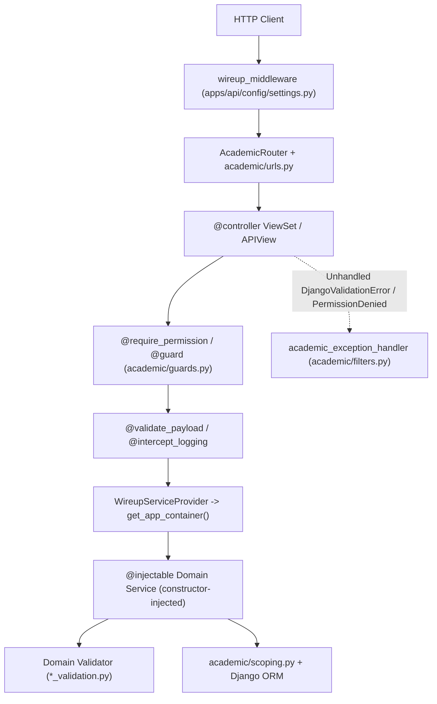

# DC-01 — Wireup Dependency Injection Container Architecture

- **Epic:** [Krr0ptioN/outcometrik#47](https://github.com/Krr0ptioN/outcometrik/issues/47)
- **Status:** Completed (`DC-01.1` through `DC-01.11`)
- **Container Library:** [`wireup`](https://maldoinc.github.io/wireup/latest/) (`wireup>=2.13,<3` with `wireup.integration.django`)
- **API Guide:** [`apps/api/AGENTS.md`](../../apps/api/AGENTS.md)

## 1. Overview & Motivation

The Outcometrik API (`apps/api/`) was migrated from an inheritance-heavy architecture built around `AcademicController` and `AcademicService` base classes into a modular, NestJS-inspired Dependency Injection (DI) architecture backed by Wireup.

The migration resolved five structural problems:

1. **Implicit base-class coupling:** Resource controllers and services previously inherited shared mutable state (`self.actor`), CRUD templates, and `get_service()` service-locator hooks from `AcademicController` and `AcademicService`.
2. **Runtime service resolution:** Services were instantiated ad hoc at request time without boot-time dependency validation.
3. **Mixed authorization boundaries:** Mutation capability checks lived inside `AcademicService.check_access`, intertwining HTTP boundary policy with domain persistence and locking.
4. **Verbose controller boilerplate:** Manual `try / except DjangoValidationError` blocks, manual serializer validation, and raw DRF `@action` workarounds obscured endpoint intent.
5. **Ad-hoc cross-cutting concerns:** Configuration, structured logging, and exception mapping lacked dedicated injectable providers and global filters.

The target architecture replaces inheritance with **composition, constructor injection, declarative boundary guards, decorator-driven routing, and global exception filtering**.

---

## 2. Architecture Overview & Request Pipeline



### Architectural Layers

| Layer | Responsibility | Location |
|---|---|---|
| **DI Bootstrap & Middleware** | Builds Wireup async container at Django startup and manages per-request scopes | `apps/api/config/settings.py` (`WIREUP`, `wireup_middleware`) |
| **Routing & Discovery** | Auto-discovers `@controller` classes and merges `@get`/`@post`/`@patch`/`@delete` actions sharing `(url, detail)` | `apps/api/academic/router.py`, `apps/api/academic/urls.py` |
| **Controller Boundary** | Thin HTTP adapter composing DRF mixins, `AcademicPagination`, `@require_permission` guards, and `@validate_payload` | `apps/api/academic/controllers/*.py` |
| **Service Resolution Seam** | Resolves `@injectable` services from Wireup `get_app_container()` while permitting constructor overrides in tests | `apps/api/academic/services/provider.py` (`WireupServiceProvider`) |
| **Domain Services** | Pure `@injectable` classes owning actor-scoped read querysets, transactions, row locks, and mutations | `apps/api/academic/services/*.py` |
| **Domain Validators** | Pure static invariant validators raising `django.core.exceptions.ValidationError` | `apps/api/academic/services/*_validation.py` |
| **Cross-Cutting Infrastructure** | Typed settings (`ApiConfig`), structured timing logs (`AppLogger`, `@intercept_logging`), global DRF filter (`academic_exception_handler`) | `apps/api/config/config_service.py`, `apps/api/academic/interceptors.py`, `apps/api/academic/filters.py` |

---

## 3. Wireup Container Registry (`WIREUP.injectables`)

Wireup is initialized through `wireup.integration.django` in `apps/api/config/settings.py`:

```python
INSTALLED_APPS = [
    ...,
    "wireup.integration.django",
    "health",
    "access",
    "academic",
]

MIDDLEWARE = [
    "django.middleware.security.SecurityMiddleware",
    "wireup.integration.django.wireup_middleware",
    ...,
]

WIREUP = WireupSettings(
    injectables=[
        "config.config_service",
        "academic.interceptors",
        "access.policy",
        "academic.services.structure",
        "academic.services.programs",
        "academic.services.offerings",
        "academic.services.enrollments",
        "academic.services.outcomes",
        "academic.services.grades",
        "academic.services.workspaces",
        "academic.services.syllabi",
        "academic.services.assessments",
    ],
    auto_inject_views=False,
)
```

`auto_inject_views` is intentionally set to `False` because DRF `ViewSet` / `APIView` classes use `academic_service_provider.provide(...)` in `__init__` (accepting optional mock services in unit tests) rather than Wireup's Django view auto-injection.

### Registered `@injectable` Services (20 Providers across 12 Modules)

| Module in `WIREUP.injectables` | `@injectable` Class(es) | Domain / Role |
|---|---|---|
| `config.config_service` | `ApiConfig` | Frozen dataclass wrapping Django runtime settings (`debug`, `secret_key`, `allowed_hosts`, `db_conn_max_age`, Celery URLs) |
| `academic.interceptors` | `AppLogger` | Structured application logger used with `@intercept_logging` |
| `access.policy` | `AuthorizationService` | Core RBAC/ABAC policy engine (`scope_ids`, `scope_filter`, `student_filter`, `allows`, `require`) |
| `academic.services.structure` | `InstitutionService`, `DepartmentService`, `AcademicTermService`, `CourseService` | Institutional catalog, departments, academic terms, and course definitions |
| `academic.services.programs` | `ProgramService`, `ProgramCourseService`, `ProgramMembershipService` | Degree programs, approved program-course links, and student memberships |
| `academic.services.offerings` | `CourseOfferingService`, `InstructorAssignmentService` | Term-scoped course offerings and instructor role provisioning |
| `academic.services.enrollments` | `EnrollmentService` | Student roster enrollments, eligibility policy, and status audit events |
| `academic.services.outcomes` | `ProgramOutcomeSetService`, `ProgramOutcomeService` | Versioned PO sets, draft PO definitions, and activation lifecycle |
| `academic.services.grades` | `GradeService`, `GradeBatchService` | Optimistic-concurrency grade entry/correction, history, and batch release |
| `academic.services.workspaces` | `WorkspaceService` | Scoped instructor, student, and program coordinator workspace read models |
| `academic.services.syllabi` | `SyllabusService` | Versioned syllabus drafting, LO/assessment management, PO-set binding, approval, and revision cloning |
| `academic.services.assessments` | `AssessmentService` | Scoped read access to approved gradebook assessments |

---

## 4. Pattern Reference

### 4.1 Controller + Decorator Routing + Guard + Validation

Controllers compose DRF mixins (`viewsets.GenericViewSet` or `APIView`) and `AcademicPagination`. Service dependencies are declared in `__init__` and default to `academic_service_provider.provide(...)`:

```python
from rest_framework import mixins, status, viewsets
from rest_framework.permissions import IsAuthenticated
from rest_framework.response import Response

from ..decorators import controller, get, post, require_permission, validate_payload
from ..serializers import (
    ProgramOutcomeSetActivateSerializer,
    ProgramOutcomeSetSerializer,
)
from ..services import ProgramOutcomeSetService, academic_service_provider
from .base import AcademicPagination


@controller("program-outcome-sets", basename="program-outcome-set")
class ProgramOutcomeSetController(
    mixins.CreateModelMixin,
    mixins.ListModelMixin,
    mixins.RetrieveModelMixin,
    viewsets.GenericViewSet,
):
    serializer_class = ProgramOutcomeSetSerializer
    permission_classes = [IsAuthenticated]
    pagination_class = AcademicPagination

    def __init__(self, service: ProgramOutcomeSetService | None = None, **kwargs):
        super().__init__(**kwargs)
        self.service = service or academic_service_provider.provide(
            ProgramOutcomeSetService
        )

    def get_queryset(self):
        filters = dict(self.request.query_params.items())
        return self.service.get_queryset(actor=self.request.user, **filters)

    @get()
    def list(self, request, *args, **kwargs):
        return super().list(request, *args, **kwargs)

    @get("{id}")
    def retrieve(self, request, *args, **kwargs):
        return super().retrieve(request, *args, **kwargs)

    @post()
    @require_permission("program.manage", scope_field="program")
    def create(self, request, *args, **kwargs):
        return super().create(request, *args, **kwargs)

    @post("{id}/activate")
    @require_permission("program.manage", scope_field="program")
    @validate_payload(ProgramOutcomeSetActivateSerializer)
    def activate(self, request, pk=None, payload=None):
        instance = self.service.activate(
            instance=self.get_object(),
            actor=request.user,
            **payload,
        )
        return Response(self.get_serializer(instance).data, status=status.HTTP_200_OK)

    def finalize_response(self, request, response, *args, **kwargs):
        response = super().finalize_response(request, response, *args, **kwargs)
        response["Cache-Control"] = "no-store"
        return response
```

Key properties of this boundary:

- **`@controller(prefix, basename=...)`** registers the class on `academic_router` (`apps/api/academic/router.py`). `apps/api/academic/urls.py` imports `academic.controllers` to auto-discover all routes.
- **`@get`, `@post`, `@put`, `@patch`, `@delete`** declare discrete, single-responsibility handlers. `AcademicRouter` maps root/detail overrides and merges multiple verbs sharing the same `(url, detail)` pattern without shadowing or `405` conflicts.
- **`@require_permission` / `@guard`** (`apps/api/academic/guards.py`) runs RBAC/ABAC capability checks before the handler executes using `scope_field` (payload or `self.get_object()` attribute traversal, e.g., `"offering.program"`, `"home_department.institution"`, `"name"`), `scope_param`, or `scope_getter`.
- **`@validate_payload` (`@validate_dto`, `@body`)** validates input with DRF serializers (auto-enabling `partial=True` on `PATCH`, supporting `merge_data` for URL parameters) and injects `payload` into handler kwargs.

### 4.2 Injectable Domain Service + Domain Validator

Domain services are standalone `@injectable` classes with explicit constructor dependencies, actor-scoped read querysets, atomic writes, and pure validator delegation:

```python
from typing import Any

from access.policy import AuthorizationService
from django.db import transaction
from wireup import injectable

from .. import scoping
from ..models import ProgramOutcomeSet
from .outcome_validation import ProgramOutcomeSetValidator


@injectable
class ProgramOutcomeSetService:
    model = ProgramOutcomeSet

    def __init__(
        self, auth_service: AuthorizationService | None = None, *, actor: Any = None
    ):
        self.auth_service = auth_service or AuthorizationService()
        self.actor = actor

    def get_queryset(self, actor: Any = None, **filters):
        effective_actor = actor if actor is not None else self.actor
        return self.visible_queryset(
            ProgramOutcomeSet.objects.all(), actor=effective_actor
        )

    @transaction.atomic
    def activate(
        self, *, instance: ProgramOutcomeSet, effective_date=None, actor: Any = None
    ):
        locked = ProgramOutcomeSet.objects.select_for_update().get(pk=instance.pk)
        ProgramOutcomeSetValidator.validate_activation(
            locked, effective_date or locked.effective_date
        )
        # Apply state transition and persist...
        return locked
```

### 4.3 Global Exception Filter & Testing Seam

- **Global exception translation:** `REST_FRAMEWORK["EXCEPTION_HANDLER"] = "academic.filters.academic_exception_handler"` converts `django.core.exceptions.ValidationError` into DRF HTTP `400` and `django.core.exceptions.PermissionDenied` into HTTP `403` with `Cache-Control: no-store`.
- **Container & constructor tests:**
  - Verify Wireup registration via `get_app_container()` and `async_container_force_sync_scope(container)`.
  - Inject mocks/stubs directly into controller constructors (`ProgramController(service=mock_service)`), bypassing `academic_service_provider`.

---

## 5. Cross-Cutting Providers & Infrastructure

- **`ApiConfig` (`apps/api/config/config_service.py`):** `@injectable @dataclass(frozen=True)` configuration provider exposing Django settings in a type-safe object.
- **`AppLogger` & `@intercept_logging` (`apps/api/academic/interceptors.py`):** `@injectable` structured logger plus execution-timing decorator for controller actions.
- **`academic_exception_handler` & `AcademicExceptionFilter` (`apps/api/academic/filters.py`):** Centralized exception filter preserving `Cache-Control: no-store`.
- **`WireupServiceProvider` (`apps/api/academic/services/provider.py`):** Minimal composition-root bridge delegating `provide(service_class)` strictly to `get_app_container()` with `async_container_force_sync_scope`. Legacy fallback instantiation was removed in `DC-01.10`.

---

## 6. Deprecation & Cleanup (DC-01.10)

The final cleanup step removed all transitional inheritance and service-locator artifacts:

- Deleted `apps/api/academic/services/base.py` (`AcademicService`, `check_access`).
- Removed `AcademicController`, `get_service()`, and legacy validation wrapper re-exports from `apps/api/academic/controllers/base.py`, retaining only `AcademicPagination`.
- Replaced `AcademicServiceProvider` and its `try/except` constructor fallback in `apps/api/academic/services/provider.py` with `WireupServiceProvider` delegating directly to Wireup's Django container.
- Migrated `apps/api/academic/test_decorators.py` off `AcademicController` onto standard DRF `mixins.CreateModelMixin, mixins.UpdateModelMixin, viewsets.GenericViewSet` verified through the global `academic_exception_handler`.

---

## 7. Migration Completion Summary (DC-01.1 – DC-01.11)

| Subtask | Issue | Merged PR | Scope Delivered |
|---|---|---|---|
| **DC-01.1** | [#53](https://github.com/Krr0ptioN/outcometrik/issues/53) | [#52](https://github.com/Krr0ptioN/outcometrik/pull/52) | Added `wireup` dependency, `WireupSettings`, `wireup_middleware`, initial `WIREUP.injectables`, and integration tests |
| **DC-01.2** | [#54](https://github.com/Krr0ptioN/outcometrik/issues/54) | [#63](https://github.com/Krr0ptioN/outcometrik/pull/63) | Added `@require_permission` / `@guard`, `ApiConfig`, `AppLogger`, `@intercept_logging`, `academic_exception_handler`, and `AcademicExceptionFilter` |
| **DC-01.3** | [#55](https://github.com/Krr0ptioN/outcometrik/issues/55) | [#64](https://github.com/Krr0ptioN/outcometrik/pull/64) | Migrated `structure` domain (`Institution`, `Department`, `AcademicTerm`, `Course`) to `@injectable` services and guarded controllers |
| **DC-01.11** | [#65](https://github.com/Krr0ptioN/outcometrik/issues/65) | [#66](https://github.com/Krr0ptioN/outcometrik/pull/66) | Built NestJS-style `@controller`, `@get`, `@post`, `@put`, `@patch`, `@delete` routing on `AcademicRouter` with auto-discovery in `academic/urls.py` |
| **DC-01.4** | [#56](https://github.com/Krr0ptioN/outcometrik/issues/56) | [#67](https://github.com/Krr0ptioN/outcometrik/pull/67) | Migrated `programs` domain (`Program`, `ProgramCourse`, `ProgramMembership`) to Wireup DI, `@controller`, and `@require_permission` |
| **DC-01.5** | [#57](https://github.com/Krr0ptioN/outcometrik/issues/57) | [#69](https://github.com/Krr0ptioN/outcometrik/pull/69) | Migrated `offerings` and `enrollments` domains (`CourseOffering`, `InstructorAssignment`, `Enrollment`) |
| **DC-01.6** | [#58](https://github.com/Krr0ptioN/outcometrik/issues/58) | [#70](https://github.com/Krr0ptioN/outcometrik/pull/70) | Migrated `outcomes` domain (`ProgramOutcomeSet`, `ProgramOutcome`) and `ProgramOutcomeSetValidator` workflows |
| **DC-01.9** | [#61](https://github.com/Krr0ptioN/outcometrik/issues/61) | [#71](https://github.com/Krr0ptioN/outcometrik/pull/71) | Migrated `workspaces` domain (`WorkspaceService` and `Instructor`/`Student`/`Coordinator` workspace controllers) |
| **DC-01.7** | [#59](https://github.com/Krr0ptioN/outcometrik/issues/59) | [#72](https://github.com/Krr0ptioN/outcometrik/pull/72) | Migrated `syllabi` and `assessments` domains (`SyllabusService`, `AssessmentService`, and controllers) |
| **DC-01.8** | [#60](https://github.com/Krr0ptioN/outcometrik/issues/60) | [#73](https://github.com/Krr0ptioN/outcometrik/pull/73) | Migrated `grades` domain (`GradeService`, `GradeBatchService`, `GradeController`, `GradeBatchController`) |
| **DC-01.10** | [#62](https://github.com/Krr0ptioN/outcometrik/issues/62) | Current PR | Removed legacy `AcademicService`, `AcademicController`, and fallback hacks; updated `apps/api/AGENTS.md` and authored this guide |
