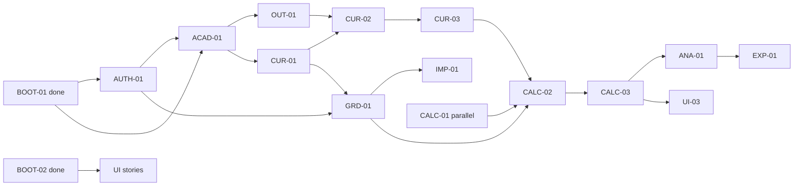

# PRD v2 implementation backlog

This backlog decomposes [the canonical PRD](../PRD.md) into epics, outcome-focused user stories, and implementation tasks. Each story is independently reviewable and lists a stable ID, epic, PRD traceability, dependencies, acceptance criteria, and tasks. Epics group value; they are not substitutes for the story tickets.

## Epics

| Epic | Outcome | Stories |
|---|---|---|
| [EPIC-01](epics/EPIC-01-foundation-identity.md) Foundation and scoped access | Runtime and least-privilege access | BOOT-01, BOOT-02, AUTH-01, AUTH-02 |
| [EPIC-02](epics/EPIC-02-academic-catalog.md) Academic catalog and roster | Versioned POs, offerings and membership | ACAD-01, OUT-01, ROST-01 |
| [EPIC-03](epics/EPIC-03-curriculum.md) Versioned curriculum and mapping | Draft and approve immutable weighted mappings | CUR-01, CUR-02, CUR-03, UI-01 |
| [EPIC-04](epics/EPIC-04-grading.md) Gradebook and safe imports | Auditable grades and previewed CSV workflows | GRD-01, IMP-01, UI-02 |
| [EPIC-05](epics/EPIC-05-attainment-publication.md) Explainable attainment and publication | Reproducible calculations and snapshots | CALC-01, CALC-02, CALC-03, DEC-01 |
| [EPIC-06](epics/EPIC-06-outcomes-and-reports.md) Student profiles and cohort reports | Scoped outcome explanations and exports | UI-03, UI-04, ANA-01, EXP-01 |
| [EPIC-07](epics/EPIC-07-quality-demo-delivery.md) Quality, reproducibility and course delivery | Synthetic demo, quality gates and honest report evidence | OPS-01, OPS-02, PERF-01 |

## Dependency order

BOOT-01 and BOOT-02 are complete foundation work. CALC-01 can proceed independently. AUTH-02 follows AUTH-01; ROST-01 follows ACAD-01 and AUTH-01; UI-01 follows CUR-02; UI-02 follows GRD-01; UI-04 follows ANA-01. OPS-01 starts from BOOT-01; OPS-02 follows the audit foundation and demo setup. PERF-01 measures delivered queries after ANA-01; it does not authorize speculative optimization work.

## Product rules carried into every ticket

- PRD v2 is authoritative. LO→PO links and course→PO relevance weights are integers 1–5. Assessment→LO weights are nonnegative relative values without a required total.
- Required roles are Administrator, Program Coordinator, Instructor and Student. Roles bundle capabilities; direct grants are separately scoped to a user/action and do not expand that scope.
- Zero, missing, exempt and unassessed/null are distinct. Decimal calculations retain full precision until display/export. Historical publications remain immutable.
- Retake eligibility, provisional visibility, course-weight ownership/scope and official rounding remain proposals in PRD §12. DEC-01 records decisions; tickets must not silently select institutional policy.
- Non-goals and deferred v1 options are listed in the PRD. TA/reviewer roles, SIS/LMS connectors, syllabus extraction, rubric scoring, what-if previews, longitudinal comparison, notification jobs and extra analytics are not MVP commitments.

## Story format and planning

Each story uses a specific role and user outcome, one or more independently verifiable Given/When/Then scenarios, implementation tasks, domain/API validation, and explicit dependencies. Pure infrastructure or measurement work is marked as an engineering task rather than disguised as a user story.

Owners, reviewers and estimates remain unassigned until the team confirms current skills, available hours and exam-week constraints. Estimate in story points as a team; do not infer hours from points or invent availability. Reserve visible capacity for reviews, integration, tests, documentation and uncertainty; refine commitments from actual delivery.

## GitHub issue status

Completed GitHub issues #2–#4 remain closed as historical BOOT-01/02 work. Issue #6 remains the active documentation task. The repository plan is the source for the revised backlog; use these IDs and acceptance criteria when creating/replacing implementation issues, and link issue dependencies to the `Blocked by` lists. Do not reopen completed bootstrap work merely because the current stories have clearer acceptance wording.
