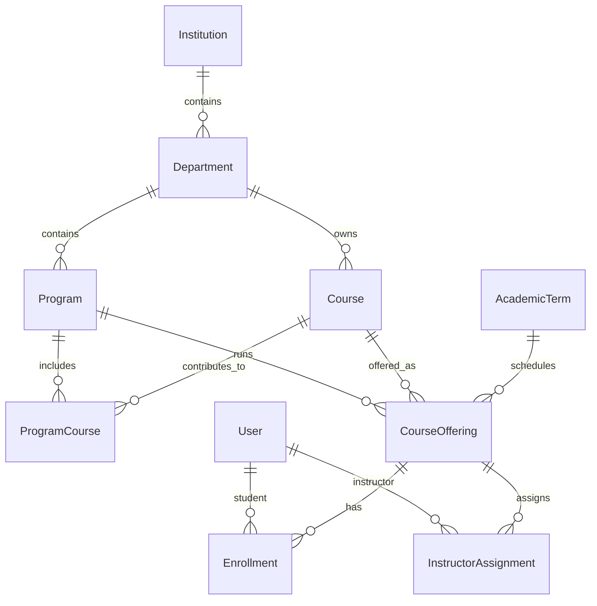

# Outcometrik — Team Jev
## CSE 311 Software Engineering → CSE 321 Data Systems

**Speaking time: 7 minutes 30 seconds, with 30 seconds for transitions.**  
Repository snapshot: 12 November 2026. Seven slides; software engineering first.

| Slide | Topic | Time |
|---|---|---|
| 1 | Project and team responsibilities | 1:00 |
| 2 | Agile workflow and GitHub Projects | 1:00 |
| 3 | Pull requests, review and trunk-based development | 1:10 |
| 4 | Completed work and current progress | 0:50 |
| 5 | System architecture and ER model | 1:30 |
| 6 | Data integrity and grade history | 1:10 |
| 7 | Features and next delivery | 0:50 |

## Part I — Software Engineering

### Slide 1 — One product, four areas of responsibility

**On the slide**

Outcometrik connects course grades to learning outcomes and program outcomes.

| Team member | Responsibility and contribution |
|---|---|
| Mardin Nasout | Project organization, frontend, infrastructure, scoped authorization and integration |
| Arsha Sharify Fakher | Academic backend, course offerings, enrollments and gradebook/history |
| Mustafa Esad Yurt | Requirements collaboration, backend review and versioned syllabus/LO/assessment work |
| Emir Şahin | CSV/PDF report export backend and frontend; peer review |

**Say**

“We divided responsibility by product area. Mardin connects the frontend, access control and infrastructure. Arsha owns the academic data and grading work. Mustafa works on curriculum versioning and contributes to requirements and backend review. Emir works on reporting and exports. The issues describe each task, while pull requests let us review and integrate the work across these boundaries.”

### Slide 2 — Our agile workflow lives in GitHub Projects

**On the slide**

**Backlog → Todo → In Progress → Done**

- Seven epics organize the product into manageable areas.
- Issues describe user stories, acceptance criteria and dependencies.
- Assignees make responsibility visible.
- We integrate small pieces and use review feedback to refine the next change.

**Visual:** Screenshot of the actual GitHub Projects board.

**Say**

“Our project board is the shared view of what we intend to build and what is moving. We break epics into issues with acceptance criteria and dependencies. For example, outcome calculation depends on curriculum mappings and grade data, so those dependencies affect what we pick up next. The board gives us visibility, and the linked pull requests show the implementation behind each task.”

### Slide 3 — Pull requests are our review meetings

**On the slide**

**Issue → branch from main → implementation → PR discussion → checks → merge to main**

- Trunk-based development: `main` is the shared integration branch.
- Task branches return directly to `main`; all nine PRs target it.
- PRs hold the explanation, review comments, requested changes and validation evidence.
- GitHub Actions runs lint, tests, type checks, builds and end-to-end checks.

**Say**

“We use pull requests as asynchronous review meetings. The author explains the change, another member can inspect it and request corrections, and the discussion stays beside the code. In the backend bootstrap PR, review specifically asked for unrelated changes to be separated. In the academic-model PR, the backend work received an approval before merging. All our pull requests target main, which keeps integration centered on one trunk.”

**Small footer:** 9 PRs opened · 6 merged · 3 open.

### Slide 4 — What we have completed

**On the slide**

**7 completed issues · 6 merged PRs · 3 open PRs**

| Completed | In open pull requests |
|---|---|
| Project organization and requirements | Versioned syllabus, LOs and assessments |
| Django/PostgreSQL and React/API foundations | Gradebook and append-only grade history |
| Scoped roles and authorization | CSV/PDF outcome report exports |
| Academic catalog, offerings and enrollments | |
| Student access restriction issue | |

**Say**

“Our completed work establishes the application foundation, scoped access and academic catalog. We have nine pull requests in total, six merged and three open. The open work covers curriculum versioning, grading and exports. We keep that distinction visible because an open implementation is still being integrated. This foundation leads directly into the data systems design.”

## Part II — Data Systems

### Slide 5 — The ER model separates a course from a course offering

**On the slide**

**Next.js frontend → Django REST API → PostgreSQL**

- **Course:** the catalog definition.
- **Course offering:** the course in a program, term and section.
- **Enrollment / InstructorAssignment:** explicit student and instructor relationships.
- **ProgramCourse:** a many-to-many association, including courses owned by another department.

**Say**

“We chose a relational model because these records have clear relationships and integrity rules. A course is the catalog definition; an offering is one delivery of that course in a particular program, term and section. This prevents different semesters from sharing the same enrollment context. Students and offerings have a many-to-many relationship through Enrollment. Instructors use a separate assignment table. ProgramCourse allows a course to contribute to more than one program without duplicating the course.”

### Slide 6 — Protecting data and preserving changes

**On the slide**

**Academic model — merged**

- Unique enrollment per student and offering.
- Unique offering per program, course, term and section.
- Enrollment requires active program membership.
- Protected references preserve academic history; roster indexes support common queries.

**Gradebook — open PR #44**

**Enrollment + Assessment → Grade → GradeHistory**

- Decimal points; measured zero differs from missing or exempt.
- Grade and history are written in one transaction.
- Version checks reject stale edits; released batches control student visibility.

**Say**

“The schema prevents duplicate enrollments and duplicate offerings, while service rules check whether a student is eligible to join an offering. We preserve referenced records rather than deleting the history behind them. Our gradebook PR extends this with a current Grade and an append-only GradeHistory. A correction records the previous value, new value, actor and reason in the same transaction. A version check prevents one instructor from silently overwriting another edit. Zero is a real score; missing and exempt are explicit states.”

### Slide 7 — Features built on this foundation

**On the slide**

| Available in merged work | Being integrated | Next |
|---|---|---|
| Scoped accounts and roles | Versioned syllabus and assessments | Assessment → LO → PO mappings |
| Academic setup workspace | Gradebook and grade history | Outcome calculation and publication |
| Offerings, memberships and rosters | CSV/PDF export implementation | Student profiles and cohort analytics |

**Target flow:** Configure course → record grades → calculate outcomes → publish → explain and export.

**Say**

“Today the merged application supports scoped accounts and academic setup, including courses, offerings and rosters. Curriculum versioning, grade history and exports are in active pull requests. The export implementation still needs the publication data source. Our next integration goal is to connect mappings, grades and calculation, then expose published results to students and coordinators. That is how the software workflow and relational model come together in the final product.”

---

## Preparation notes — not spoken

- Counts are live GitHub records checked on 12 November 2026: **9 PRs = 6 merged + 3 open**. **7 issues have completion status** (#1, #3, #4, #6, #16, #18, #41); #2 is a duplicate closure and is excluded. This is an issue count, not seven completed product features.
- Completed PRs: #5, #7, #8, #39, #40, #42. Open PRs: #43 exports, #44 gradebook, #45 curriculum. Local gradebook work exists, but it is not counted as merged delivery.
- The responsibility mapping is based on issue assignments and PR authorship. Confirm **Mustafa ↔ nullterminator-fyi** before finalizing the name table; the account's public profile does not expose a real name. Other mappings: Mardin/Krr0ptioN, Arsha/Arsha-shf, Emir/conscientious05.
- PR review is the team's stated working practice. Review records show concrete examples, but do not support saying that every merge received independent approval or that branch protection enforces it.
- Keep the ER diagram limited to the merged academic model. Label grade history and curriculum as open-PR work. Do not claim that the outcome engine or live report exports are complete.
- No velocity or story-point total is included: reliable completed-sprint measurements were not established.

## Evidence links — not spoken

- [GitHub Projects board](https://github.com/users/Krr0ptioN/projects/9)
- [Completed issues](https://github.com/Krr0ptioN/outcometrik/issues?q=is%3Aissue+is%3Aclosed)
- [All pull requests](https://github.com/Krr0ptioN/outcometrik/pulls?q=is%3Apr)
- [Backend bootstrap and review #5](https://github.com/Krr0ptioN/outcometrik/pull/5)
- [Scoped authorization #39](https://github.com/Krr0ptioN/outcometrik/pull/39)
- [Academic model and review #40](https://github.com/Krr0ptioN/outcometrik/pull/40)
- [Academic setup UI #42](https://github.com/Krr0ptioN/outcometrik/pull/42)
- [Export implementation and integration limitation #43](https://github.com/Krr0ptioN/outcometrik/pull/43)
- [Gradebook and history #44](https://github.com/Krr0ptioN/outcometrik/pull/44)
- [Versioned curriculum #45](https://github.com/Krr0ptioN/outcometrik/pull/45)
- [Current local academic model](../../apps/api/academic/models.py)
- [CI workflow](../../.github/workflows/ci.yml)
